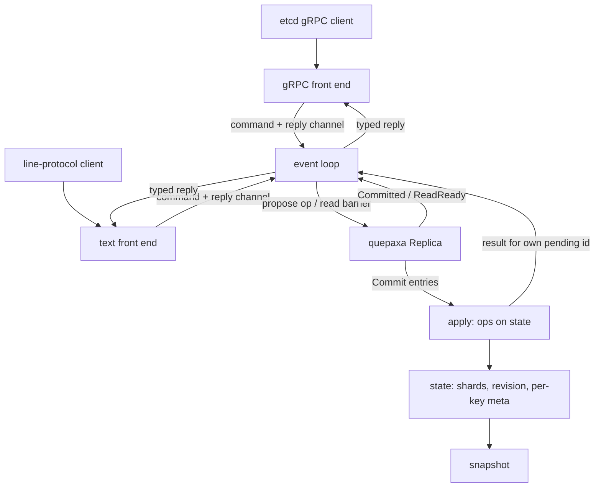
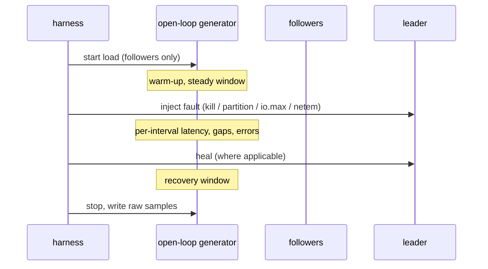

# etcd-Compatible Front End and Benchmark - Plan

## Goal Capsule

- **Objective:** Anyone can run one command on a Linux machine with Docker and get a side-by-side comparison of a QuePaxa-replicated KV store and etcd, driven by the same clients, in steady state and while the leader crashes, is partitioned, has a slow disk, or sits far away, with a published report that states where QuePaxa loses as plainly as where it wins.
- **Means:** `kv-tokio` also serves a wire-compatible subset of etcd's v3 KV gRPC API (KTD1), so etcd's own `benchmark` tool and an open-loop generator drive both systems identically (KTD8).
- **Authority:** the Product Contract's Requirements win on behavior; KTDs win on mechanism; units implement both and override neither.
- **Stop conditions:** stop and ask if wire compatibility needs etcd APIs outside R1–R4 for etcd's tools to run; if a fault scenario cannot be injected equally on both systems on this kind of host; or if keeping one implementation (KTD1) forces a change to the `quepaxa` crate's public API.
- **Execution profile:** sequential units; U1–U3 are code with tests, U4 is a load generator, U5–U6 are harness and report verified by running them.
- **Ships via:** pull requests to `main` under the repository's usual review (CI, Codex review, cross-model review for the larger units).

---

## Product Contract

### Summary

Add an etcd v3 KV gRPC front end to the `kv-tokio` example, backed by the same replica, storage and state as its text protocol, and a Docker-based harness that compares it with etcd under steady load and four leader-fault scenarios, ending in a report in `docs/benchmarks.md`.

### Problem Frame

QuePaxa's claim is that a slow or dead leader costs latency but never a stall waiting for an election timeout. The repository has no evidence for that claim against a Raft system: `kv-tokio` speaks a line protocol of its own, so etcd's clients and benchmark tools cannot drive it, and every existing number (`docs/benchmarks.md`) measures QuePaxa alone. A reader weighing QuePaxa against etcd today has to take the claim on trust. The comparison is only credible if the same clients drive both systems on the same host under the same faults, and if steady-state results are published even where etcd is faster.

### Key Decisions

- **An etcd API subset plus a comparison benchmark, not a full etcd clone.** Governs R1, R4, R7. (session-settled: user-directed — chosen over a full etcd clone with watch, lease and MVCC history, and over fault tests of QuePaxa alone: the subset is what lets etcd's tools drive both systems, and the rest is unrelated to consensus)
- **The work lives under `examples/` in this repository and is not published.** Governs R12. (session-settled: user-directed — chosen over a separate repository: it builds and tests with the crate it demonstrates)

### Requirements

**etcd API surface**

- R1. `kv-tokio` serves etcd v3's `etcdserverpb.KV` service over gRPC, wire-compatible for `Put`, `Range`, `DeleteRange` and `Txn`, so etcd's Go client, `etcdctl` and etcd's `benchmark` tool work against it unmodified for these calls.
- R2. Store revisions behave as etcd's do for a single store without history: every committed write request raises the revision by one, every key carries its create revision, mod revision and version, and all replicas compute identical values.
- R3. Writes are acknowledged only once committed, and `Range` is linearizable unless the request asks for serializable, in which case the contacted replica answers locally.
- R4. A request that needs a feature outside the subset (a past revision, leases, watch, compaction, nested transactions, sorting) is rejected with an explicit gRPC error, never answered approximately.
- R5. The existing line protocol, its tests and `kv-bench` keep working against the same nodes.

**Comparison**

- R6. Steady-state throughput and latency (p50, p99) for put, linearizable range, serializable range and single-key transactions are measured on both systems with etcd's own `benchmark` tool.
- R7. Four fault scenarios are measured on both systems with the same open-loop load: leader crash, leader network partition, slow leader disk, and a leader placed far from the other members.
- R8. etcd is measured both with its default timeouts and with aggressively tuned ones, so the comparison is not against a strawman.
- R9. Every fault result shows the effect over time, not only an aggregate: the longest stretch without completed requests, latency per short interval around the fault, errors, and time to return to steady state.

**Harness and report**

- R10. One command per scenario (and one for all) builds, runs and tears down each cluster, with pinned versions, and keeps raw results.
- R11. `docs/benchmarks.md` gains a comparison section with environment, method, results and caveats, marked as measurements of one host that are hypotheses rather than production claims.
- R12. Nothing new is published to crates.io, and the `quepaxa` crate's public API does not change.

### Success Criteria

- The full harness runs end to end on the 16-vCPU development VM, and the report covers every scenario in R6–R8 or states why one could not be measured fairly.
- `etcdctl put/get/del/txn` against a `kv-tokio` cluster behave as against etcd for the subset.
- A reader can tell from the report alone where QuePaxa is faster, where etcd is, and by how much.

### Scope Boundaries

- Out of scope: watch, leases, authentication, MVCC history and compaction, `Cluster`/`Maintenance`/`Auth`/`Lease`/`Watch` services, multi-key or nested transactions beyond R1, TLS.
- Out of scope: changing the `quepaxa` crate to win a benchmark; tuning found necessary is reported, not hidden.
- Considered and not built: Prometheus metrics endpoints. The harness reads latency from the clients, which is what users experience; would change if a server-side breakdown is needed to explain a result.

#### Deferred to Follow-Up Work

- Multi-host runs on real networks instead of `tc netem` on one host.
- A CI job that runs the comparison; it takes too long for per-PR CI and its numbers are host-dependent. A gRPC integration test does run in CI (U3).

---

## Planning Contract

### Key Technical Decisions

- KTD1. **The `kv-tokio` node serves both protocols from one replica, storage and state.** The gRPC server is a second front end that sends commands into the existing event loop, alongside the line-protocol client handler; there is no second store or binary. (session-settled: user-approved — chosen over a separate etcd-compat example: one implementation of apply, storage and snapshots, at the cost of gRPC dependencies in `kv-tokio`)
- KTD2. **Operations, not puts, go into the log.** A committed entry is a tagged operation (put, delete range, or transaction with compares and success/failure branches) evaluated deterministically at apply time; its result (previous values, deleted count, whether a transaction succeeded, revision) is computed then. The line protocol's `PUT` becomes the put operation. The log and snapshot formats change without migration, per the repository's fast-iteration stance (one CHANGELOG line).
- KTD3. **Replies are typed.** Client commands reply with a result value instead of a `String`; the line protocol formats it, the gRPC front end maps it. A result reaches the requester through `Action::Committed { id, slot }`: the apply step keeps results of this replica's own entries (origin is this replica) by slot and id, and `Committed` takes the one at its slot; if two own entries share that id in that slot (an earlier incarnation's entry decided late), the one whose payload equals the pending proposal's wins. The replica's incarnation is not public and R12 keeps it so. When an installed snapshot resolved the proposal, no result exists: a put or delete without `prev_kv` succeeds with the current revision, anything whose answer depends on the result (a transaction's branch, `prev_kv`) reports its outcome as unknown. Entries from other replicas apply without a reply.
- KTD4. **Revisions without history.** The state keeps a store revision, raised once per committed request that writes, and per-key create revision, mod revision and version, all part of the snapshot. `Range` at revision 0 only; any other revision gets `Unimplemented` (R4). The response header carries the revision, a cluster id derived from the configured cluster id, the replica id as member id, and raft term 0.
- KTD5. **Keys and values become bytes.** etcd keys are arbitrary bytes; the shards keep hashing for snapshot sharing, and range queries merge the shards in key order, with `limit`, `count_only` and `keys_only`. Point lookups stay constant-time; prefix scans cost a pass over the shards, which the comparison does not exercise beyond point ranges.
- KTD6. **Protos are vendored and trimmed, compiled without `protoc`.** `examples/kv-tokio/proto/` holds the `KV` service and the messages it uses, copied from etcd v3.7.2's `rpc.proto` and `kv.proto` with package, service, message names and field numbers unchanged and the Apache-2.0 headers kept; imports of gogoproto, Google API annotations, auth and version options are removed. `build.rs` compiles them with `protox` and `tonic-prost-build`. Versions, the newest at least two weeks old: `tonic`, `tonic-prost`, `tonic-prost-build` 0.14.6; `prost` 0.14.4; `protox` 0.10.0. Supply chain: about a dozen new crates under MIT/Apache-2.0 (tonic, prost, hyper, h2, tower and their dependencies), all from the tokio and prost projects already trusted for `tokio`; `cargo deny` must pass.
- KTD7. **Errors map to the codes etcd clients retry on.** `Busy` and a fenced replica map to `Unavailable` so the Go client retries elsewhere; unsupported fields to `InvalidArgument` or `Unimplemented` (R4); a lost outcome after fencing to `Unknown`.
- KTD8. **Steady state uses etcd's `benchmark`; faults use an open-loop generator.** etcd's tool is closed-loop: during a stall its clients wait, so requests that would have arrived are never issued and the stall is undercounted (coordinated omission). It stays for steady state, where it makes results comparable with etcd's own published numbers. Fault scenarios use `kv-bench` extended to speak the etcd gRPC subset with Poisson arrivals, recording each request's send and completion times so stalls show in full; the same generator drives both systems.
- KTD9. **Faults are injected identically outside the processes.** Clients connect only to followers in every fault scenario, so the measured effect is the cluster's reaction to losing its leader, not the client losing its server. Network faults run from a privileged sidecar sharing the target's network namespace, because etcd's official image is distroless (no shell, `iptables` or `tc`); the same sidecar serves both systems. Crash: `SIGKILL` of the leader container. Partition: the leader's traffic to its peers is dropped with `iptables` while clients stay connected to followers. Slow disk: cgroup v2 `io.max` limits on the leader's data device (`--device-write-iops`/`--device-write-bps`); `LD_PRELOAD` cannot slow etcd, which calls `fdatasync` without libc. Far leader: `tc netem` delay on the leader's interface. etcd's leader is found from endpoint status before the fault; QuePaxa's is fixed with `--leader-order`.
- KTD10. **Fair resources.** One system runs at a time. Each node runs in its own container with a disjoint `cpuset` and the same CPU count, the generator on its own cores, data on the same host disk (never tmpfs), `fsync` on for both, the same client placement and the same request sizes (8-byte keys and values unless a scenario says otherwise). etcd v3.7.2 runs from its official image pinned by digest; `benchmark` is built from the same tag.
- KTD11. **etcd timeouts.** Default (heartbeat 100 ms, election 1000 ms) and tuned (heartbeat 10 ms, election 100 ms) runs; the tuned run is the strongest honest etcd configuration for a single-host network.

### High-Level Technical Design

Request path inside a replica (both front ends share everything below them):



Fault scenario timeline as the harness runs it:



### Output Structure

```text
examples/kv-tokio/
  build.rs
  proto/                     # trimmed etcd v3.7.2 protos (Apache-2.0)
  src/
    ops.rs                   # operation format, apply, results, revisions
    grpc.rs                  # etcd KV front end
    kv.rs                    # byte keys, per-key meta, ordered ranges
    node.rs, main.rs, storage.rs
    bin/kv-bench.rs          # + etcd protocol, timeline output
  tests/
    etcd_api.rs
  bench/etcd/
    compose/                 # quepaxa and etcd clusters, generator, benchmark image
    run.sh                   # one scenario or all
    scenarios/               # steady, crash, partition, slow-disk, far-leader
    summarize                # raw samples to tables
docs/benchmarks.md           # comparison section
```

### Assumptions

- The development VM's kernel exposes cgroup v2 `io.max` for the disk Docker uses; if it does not, the slow-disk scenario is reported as not measured (U5 verifies first).
- etcd's Go client works against the subset without `Maintenance` or `Cluster` calls when `benchmark` runs without `--target-leader`, `--check-hashkv` or `--compact-interval` (confirmed from `tools/benchmark/cmd` at v3.6.5 and to be rechecked at v3.7.2 in U3).

---

## Implementation Units

### U1. Operations, revisions and byte keys in the state

**Goal:** The replicated state applies etcd-shaped operations deterministically and reports their results.

**Requirements:** R1, R2, R4, R5

**Dependencies:** none

**Files:**
- `examples/kv-tokio/src/ops.rs` (new)
- `examples/kv-tokio/src/kv.rs`
- `examples/kv-tokio/src/node.rs` (snapshot encoding only)

**Approach:**
1. Define the operation format (KTD2) with a leading tag byte, its encoding and decoding, and the result type each operation produces.
2. Move `Kv` to byte keys and values with per-key create revision, mod revision and version, plus the store revision (KTD4, KTD5); add delete and ordered range across shards with `limit`, `count_only`, `keys_only`.
3. Apply: put, delete range and transaction (compare on value, version, create revision, mod revision with equal, not-equal, less, greater; branches of put, range, delete range). A request that writes raises the revision once.
4. Snapshot encoding includes the revision and per-key metadata.

**Patterns to follow:** `Kv`'s shard sharing and its test in `examples/kv-tokio/src/kv.rs`; `encode_put`/`decode_put` and the snapshot round trip in `examples/kv-tokio/src/node.rs`.

**Test scenarios:**
- A put on a new key sets create revision = mod revision = store revision and version 1; a second put keeps the create revision, raises mod revision and version.
- A delete range over three keys returns 3, raises the revision once, and a later put on one of them starts a new create revision with version 1.
- A transaction whose compare on mod revision holds runs its success branch; changing the compare to not hold runs the failure branch; both report which branch ran.
- A transaction with only ranges does not raise the revision.
- A range with `range_end` over keys in different shards returns them in key order; `limit` 2 returns the first two with `more` set; `count_only` returns only the count.
- Keys with arbitrary bytes, including zero bytes, round-trip through encoding, apply and snapshot.
- An unknown operation tag decodes as invalid and applies as a no-op on every replica alike.
- A snapshot taken mid-sequence and restored yields the same revision and per-key metadata as the live state.

**Verification:** the state's unit tests pass, and two states fed the same operations in the same order compare equal.

### U2. Typed replies through the event loop

**Goal:** Every client command receives its operation's result, computed at apply time, through one reply path both front ends use.

**Requirements:** R3, R5

**Dependencies:** U1

**Files:**
- `examples/kv-tokio/src/node.rs`
- `examples/kv-tokio/src/main.rs` (line protocol formatting)
- `examples/kv-tokio/tests/cluster.rs`

**Approach:**
1. Commands carry an operation or a range with its consistency; replies carry the typed result (KTD3).
2. At `Commit`, apply each entry and keep the results of this replica's own entries for `Committed` to match by slot and id (KTD3).
3. Linearizable ranges go through the read barrier and evaluate at `ReadReady`; serializable ranges answer at once.
4. The line protocol maps `PUT`/`GET`/`STALE` onto these and formats replies exactly as before.

**Patterns to follow:** `on_client` and `drain` in `examples/kv-tokio/src/node.rs`; the `writes`/`reads` maps keyed by `ProposalId`.

**Test scenarios:**
- The line protocol's existing cluster tests pass unchanged.
- A put proposed at replica 1 and a put of the same key proposed at replica 2 both commit; each requester sees the previous value its own operation observed in log order.
- An entry decided twice (hedged and forwarded) is applied once and answered once.
- A command pending when the replica fences gets a failure reply, never silence.
- A transaction whose proposal an installed snapshot resolves reports an unknown outcome; a plain put resolved the same way reports success.
- After a restart, a late-decided entry from the previous incarnation with the same id as a new pending proposal does not answer the new one.

**Verification:** `kv-tokio`'s tests pass and `kv-bench` still runs against a local cluster.

### U3. etcd KV gRPC front end

**Goal:** `kv-tokio --etcd ADDR` serves the `KV` service so etcd's client and tools work for R1.

**Requirements:** R1, R3, R4, R12

**Dependencies:** U2

**Files:**
- `examples/kv-tokio/proto/` (new, trimmed protos)
- `examples/kv-tokio/build.rs` (new)
- `examples/kv-tokio/src/grpc.rs` (new)
- `examples/kv-tokio/src/main.rs` (flag, server start)
- `examples/kv-tokio/Cargo.toml`
- `examples/kv-tokio/tests/etcd_api.rs` (new)
- `Cargo.lock`, `deny.toml` if license entries are needed

**Approach:**
1. Vendor and trim the protos and compile them at build time (KTD6).
2. Map each RPC onto commands; build response headers (KTD4); reject unsupported fields (R4) and map errors (KTD7).
3. Start the server on the shared Tokio runtime when `--etcd` is given.
4. Before relying on etcd's tools, recheck at v3.7.2 which RPCs `benchmark put/range/txn-put` and `etcdctl` call.

**Execution note:** Start with the integration test's request/response contract against a three-replica cluster, then fill the mapping.

**Patterns to follow:** the client handler and `push` into the event queue in `examples/kv-tokio/src/main.rs`; the process-level cluster helpers in `examples/kv-tokio/tests/common`.

**Test scenarios:**
- Put then linearizable range on another replica returns the value with matching mod revision.
- Put with `prev_kv` returns the previous key-value; delete range with `prev_kv` returns the deleted pairs.
- A compare-and-swap transaction on mod revision succeeds once and fails when retried with the stale revision.
- Prefix range (`range_end` = prefix + 1) and the all-keys form (`key` and `range_end` both `\0`) return keys in order.
- Range at a non-zero revision, a lease on put, sort order, and a nested transaction each return the documented error code.
- With the replica fenced, calls return `Unavailable`.
- Serializable range on a follower may return a stale value but never one from the future.

**Verification:** the integration test passes in CI; manually, `etcdctl put/get/del/txn` and `benchmark put --total 1000` complete against a local cluster.

### U4. Open-loop etcd load and timelines in kv-bench

**Goal:** One generator drives both systems over the etcd protocol and records what happens over time.

**Requirements:** R7, R9

**Dependencies:** U3

**Files:**
- `examples/kv-tokio/src/bin/kv-bench.rs` (split into modules if it passes ~500 lines)
- `examples/kv-tokio/src/bin/kv_bench/` (new, if split)

**Approach:**
1. Add an etcd mode using the U3 client stubs, which both binaries include from the build's output directory (the package has no library target); Poisson arrivals at a fixed rate regardless of completions (KTD8), each request timestamped at intended send and completion.
2. Output raw samples (intended send, completion, outcome) and a per-interval summary: completed, errors, p50/p99/max, plus the longest gap with no completion and time to return within 20% of pre-fault throughput.
3. Accept fault markers (times) from the harness so summaries split before/during/after.

**Patterns to follow:** the existing Poisson loop, `SplitMix` and percentile code in `examples/kv-tokio/src/bin/kv-bench.rs`.

**Test scenarios:**
- Given synthetic samples with a 2-second gap, the summary reports a 2-second longest gap and the interval rows show it.
- A request still outstanding at the end is counted as unanswered, with its latency measured to the end of the run, not dropped.
- Latency is measured from the intended send time, so a generator that falls behind still reports the delay (coordinated omission check).
- The line-protocol mode's output is unchanged.

**Verification:** running it against a local `kv-tokio` cluster in etcd mode for 10 s produces raw samples and a summary consistent with the line-protocol mode's numbers.

### U5. Docker harness and fault scenarios

**Goal:** One command builds, runs, faults and tears down each cluster and stores raw results.

**Requirements:** R6, R7, R8, R10

**Dependencies:** U3, U4

**Files:**
- `examples/kv-tokio/bench/etcd/` (new: compose files, `run.sh`, scenario scripts, summarizer, README)
- `.gitignore` (results directory)

**Approach:**
1. Compose definitions for a three-replica `kv-tokio` cluster, three-member etcd at defaults and tuned (KTD10, KTD11), the fault sidecar (KTD9), the generator, and the `benchmark` image built from etcd v3.7.2.
2. Steady state: `benchmark put`, `range` (both consistencies) and `txn-put` at a ladder of rates and unlimited (R6).
3. Faults: crash, partition, slow disk and far leader per KTD9, each with warm-up, fault window and recovery window, clients on followers only.
4. Raw outputs and environment (kernel, CPU, disk fsync latency, image digests, commit) under a timestamped results directory; a summarizer turns them into the report's tables.

**Execution note:** Verify each injection works on this host before measuring: an `io.max` limit visibly slows a test write in the container, and `iptables` drops show in counters; a scenario that cannot be injected equally is reported, not faked.

**Patterns to follow:** `examples/kv-tokio/run-local.sh` (data on a real disk with a tmpfs warning, cleanup trap, netem ownership).

**Test expectation:** none -- harness scripts; proven by the smoke run below.

**Verification:** a smoke run with short windows completes every scenario on both systems and leaves raw results and a summary; cleanup leaves no containers, networks or qdiscs behind.

### U6. Comparison report

**Goal:** `docs/benchmarks.md` reports the comparison honestly.

**Requirements:** R9, R11

**Dependencies:** U5

**Files:**
- `docs/benchmarks.md`
- `examples/kv-tokio/bench/etcd/README.md`
- `README.md` (one link)
- `CHANGELOG.md`

**Approach:**
1. Environment, versions, method (closed vs open loop, client placement, fault mechanics), then steady-state tables and per-scenario timelines as tables.
2. State where each system wins, the tuned-etcd results next to defaults, and the single-host caveat in the existing voice of `docs/benchmarks.md`.
3. CHANGELOG: the etcd front end, the log and snapshot format change, the harness.

**Test expectation:** none -- documentation.

**Verification:** every number in the report traces to a raw results directory named in it; a reviewer can reproduce one scenario from the README.

---

## Risks & Dependencies

| Risk | Mitigation |
|---|---|
| QuePaxa is slower than etcd in steady state | Published as measured (R11); explained where the data supports it |
| A transitive gRPC dependency needs a Rust newer than the workspace MSRV 1.89 | Checked in U3 by the `msrv` CI job; pin an older patch release or raise MSRV for the example only after asking |
| `cargo deny` rejects a new license or advisory | Resolved in U3 before merge |
| cgroup `io.max` does not slow `fsync` on this VM's disk | Verified first in U5; scenario reported as not measured if so |
| One host shares CPU and disk between nodes and clients | Disjoint cpusets, same placement for both systems, caveat in the report |
| etcd's tools call RPCs outside the subset at v3.7.2 | Rechecked in U3; stop condition in the Goal Capsule |

---

## Verification Contract

| Gate | Command or check | Applies to |
|---|---|---|
| Unit and integration tests | `cargo nextest run -p kv-tokio` | U1–U4 |
| Workspace tests | `cargo nextest run --workspace` | all code units |
| Lint | `cargo clippy --workspace --all-targets -- -D warnings`, `cargo fmt --all --check` | all code units |
| MSRV and licenses | CI `msrv` and `deny` jobs | U3 |
| Wire compatibility | `etcdctl` and `benchmark put --total 1000` against a local cluster | U3 |
| Harness smoke | `examples/kv-tokio/bench/etcd/run.sh` with short windows | U5 |
| Report traceability | each table names its raw results directory | U6 |

---

## Definition of Done

- All units' verification passes, CI is green, and the cross-model review of the code units found nothing unresolved that affects correctness.
- The report in `docs/benchmarks.md` covers R6–R9 from a full run, with every number traceable to raw results.
- No experimental or abandoned code from tried approaches remains in the diff.
- `kv-tokio`'s line protocol, tests and `kv-bench` behave as before (R5).

---

## Sources & Research

- etcd `tools/benchmark/cmd` (`put.go`, `range.go`, `txn_put.go`, `util.go`) at v3.6.5: `put`, `range` and `txn-put` use only `KV.Put`, `KV.Range` and `KV.Txn`; `MemberList` and `Status` only with `--target-leader`, `Compact` only with `--compact-interval`, `HashKV` only with `--check-hashkv`. The tool is closed-loop with an optional rate limit (KTD8).
- crates.io versions as of 2026-10-29: tonic/tonic-prost/tonic-prost-build 0.14.6 (2026-05-07, MSRV 1.88; 0.14.7 and 0.14.8 are from 2026-10-27), prost 0.14.4, protox 0.10.0 (2026-10-07, MSRV 1.85, depends on prost 0.14).
- etcd releases: v3.7.2 (2026-09-22) is the newest at least two weeks old; v3.7.3 is from 2026-10-22.
- Existing measurement method and caveats: `docs/benchmarks.md`, `examples/kv-tokio/run-local.sh`, `examples/kv-tokio/src/bin/kv-bench.rs`.
