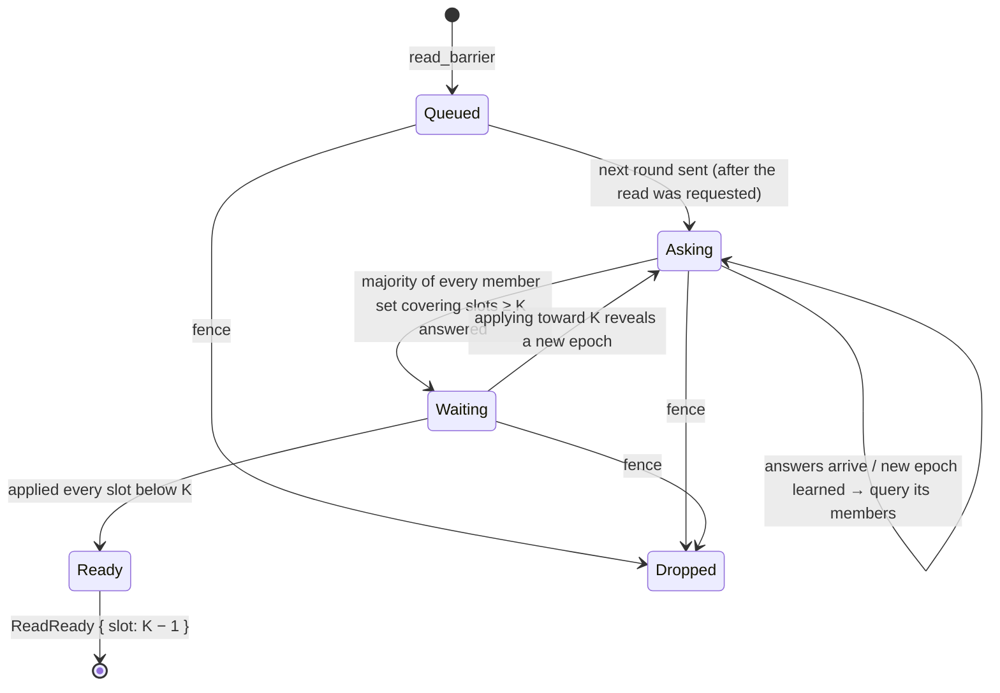
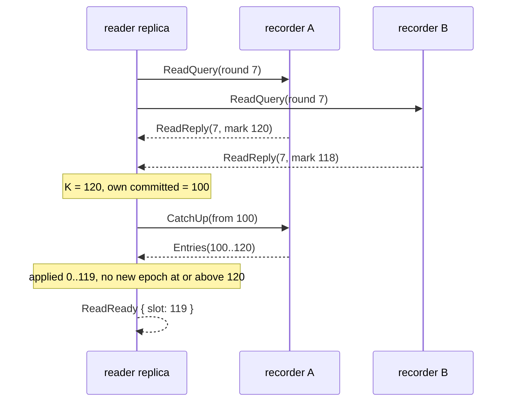

# Linearizable Reads Without a Log Slot - Plan

## Goal Capsule

- **Objective:** A linearizable read on any QuePaxa replica costs one round trip to a majority in the common case (more when the reader lags or a high-water slot is still undecided) and no disk write or log slot, so read-heavy users get several times today's read throughput with the same guarantee: a read reflects every write that completed before it started, through crashes, leader rotation, hedging and membership changes.
- **Means:** a quorum high-water read (KTD1): the reading replica asks recorders for the highest slot they hold state for, waits until it has applied every slot below the largest answer, and covers every epoch that reaches past it (KTD4).
- **Authority:** the Product Contract's Requirements win on behavior; KTDs win on mechanism; units implement both and override neither.
- **Stop conditions:** stop and report if TLC finds a counterexample the epoch rule (KTD4) cannot be repaired within this design; if the read cannot keep `read_barrier` / `ReadReady` semantics (R2) without weakening them; or if a verification layer (model, simulator oracle, canaries) cannot be made to catch the seeded read bugs.
- **Execution profile:** model first (U1), then wire, recorder and reader code test-first (U2-U4), then simulator and canaries (U5), docs (U6), benchmark (U7).
- **Ships via:** pull requests to `main` under the repository's usual review (CI, Codex review, cross-model review for U1 and U4).

---

## Product Contract

### Summary

Replace the log-based read barrier behind `Replica::read_barrier` with a quorum high-water read that needs no consensus slot and no `fsync`, keep the public API and its guarantee, prove the protocol in TLA+ before coding it, and measure the gain in the etcd comparison.

### Problem Frame

Every linearizable read today proposes a barrier entry: it waits for a slot to be decided, which costs a consensus round and a durable write at a majority of recorders. Barriers batch, but under etcd's benchmark `kv-tokio` serves about 31,000 linearizable ranges per second against etcd's 100,000 (`docs/benchmarks.md#against-etcd`), the report's largest remaining loss. etcd avoids the log with ReadIndex, which relies on a leader confirming its leadership; QuePaxa has no stable leader and assumes no clock bounds, so neither ReadIndex nor lease reads carry over. Quorum reads (PQR) need neither: any completed write is held by a majority of recorders, so a majority's highest recorded slot bounds it.

### Key Decisions

- **A quorum high-water read, not ReadIndex, leases, or a cheaper log barrier.** Governs R1, R3. (session-settled: user-approved — chosen over leader ReadIndex, which needs a stable leader; lease reads, which need clock bounds; and cheaper barrier slots, which still cost a consensus round)

### Requirements

**Read guarantee**

- R1. A read reports ready only once the replica has applied every write that completed (anywhere) before the read was requested, and never reflects less than a read that completed before it was requested.
- R2. `Replica::read_barrier` keeps its signature and errors; each id appears in exactly one `Action::ReadReady { id, slot }` or `Action::Dropped`; `ReadReady` follows the `Commit` of every slot it covers, and its `slot` keeps its meaning: the application has applied every commit up to and including it.
- R3. R1 holds on any replica, including one that lags, one joining or removed but not yet retired, one just restarted, and across leader rotation, hedging, compaction, snapshot install, and membership changes, including several changes learned at once.
- R4. A read neither proposes a log entry nor waits for a durable write; a recorder answers from memory.

**Liveness and cost**

- R5. A read completes while a majority of the relevant members is reachable, including when its high-water slot is undecided (it is driven) or the reader lags (it catches up).
- R6. Many concurrent reads share one round; reads count against the replica's outstanding-proposal limit, as barriers do today.

**Verification and evidence**

- R7. A TLA+ model checks R1 with TLC, including crashes, compaction, a removed but live recorder, and a reader that learns two membership changes at once; seeded protocol bugs each yield a counterexample. A TLAPS proof covers fixed membership.
- R8. The simulator's linearizability oracle and the delay-bounded model checker exercise the new read path, and seeded code bugs in it are caught by canaries.
- R9. Documentation, glossary, FFI comments and CHANGELOG describe the new read; `docs/benchmarks.md` reports the measured before/after.

### Success Criteria

- `kv-tokio` linearizable range throughput under etcd's `benchmark` (same host and harness as `docs/benchmarks.md#against-etcd`) is at least 2.5x today's (about 31,000/s), with write throughput unchanged within noise.
- A read-heavy mixed run (90% linearizable range, 10% put) reports read throughput and latency before and after; its gain is stated next to the read-only one, whatever it is.
- Every TLC configuration, the TLAPS proof, the simulator seeds, the model checker and all canaries pass; every new seeded bug is caught.

### Scope Boundaries

- No lease or clock-based reads; no change to the serializable read path (`STALE` / `serializable: true` read local state as today).
- No per-key or flexible-quorum read optimisations (PQR's variants).
- The retirement barrier that a retiring replica takes stays as it is.
- Considered and not built: a timeout that drops a read whose high-water slot never decides. Takeover already decides every seen slot (R5), and `Dropped` on fence covers the stuck-replica case; evidence of a read stuck with a reachable majority would change this.
- Considered and not built: making recorders refuse reads until they know their epoch's start state (the paros fix). Under KTD4 the reader chooses epochs from its own decided schedule and repliers report a config-free number, so a stale replier cannot mislead it; U1's model checks this with a removed but live recorder.

#### Deferred to Follow-Up Work

- Serving reads at a replica whose state is already past every reply without waiting for a round (lease-like fast path): needs its own proof.

---

## Planning Contract

### Key Technical Decisions

- KTD1. **Quorum high-water read.** The reading replica sends a read query to recorders, takes the largest high-water mark K among the answers it accepts (KTD4), waits until it has applied every slot below K, then reports ready. It implements the Key Decision and inherits its label (session-settled: user-approved — chosen over ReadIndex, leases and cheaper barriers). Safety rests on two facts verified in the code: a slot is decided only on replies from a quorum of its recorders (`proposer.rs`), and a recorder replies only after its register is durable (`send_gated` / `LocalReply` in `replica/log.rs`).
- KTD2. **High-water mark.** A recorder's mark is the exclusive bound `max(last register + 1, last decided log entry + 1, floor)`. Registers alone are unsound: a register is removed once its decision is durable (`Effect::DecidedDurable`) and slots below `floor` are compacted. The mark is derived on demand from existing state and rebuilt on restart from durable records; no new record type.
- KTD3. **Ungated answers.** A recorder answers a read query from memory without waiting for pending persists (R4). The in-memory mark is never below the durable one, and a mark that is too high only makes the reader wait for that slot, which takeover decides. ADR 0002's persist-before-send rule guards answers whose loss could make them too low; this one cannot be.
- KTD4. **Epoch coverage.** The read is ready when, for every distinct member set in the reader's schedule history that covers a slot at or above K, a majority of those members answered a round sent after the read was requested, K is the largest mark among all accepted answers, and the replica has applied every slot below K. Learning new epochs while catching up adds member sets; the reader queries them and recomputes. Leader-rotation entries share member sets and are deduplicated. Answers from rounds sent before the read was requested never count.
- KTD5. **Rounds.** At most one read round is in flight per replica; it carries a round number that replies echo. Reads requested after a round was sent join the next one. The round is retransmitted to members that have not answered on the retransmit timer. A single-member cluster answers itself through the inbox, the same path as `send(self.me, …)`.
- KTD6. **Waiting for K.** While below K the reader marks the undecided slots up to `min(K, committed + window)` as seen, so stalled-slot takeover drives them, and requests catch-up from the peer that reported the largest mark when that mark is ahead of what it has decided.
- KTD7. **API and terms.** `read_barrier` and `ReadReady` keep their shape; `ReadReady.slot` is the last slot the read covers (K − 1). K is at least 1: when every answer is 0 (nothing recorded anywhere, a fresh cluster), the reader raises K to 1 and marks slot 0 seen, so takeover decides it once in the cluster's lifetime and R2's inclusive meaning holds. Ids still come from `next_proposal` and pending reads still count in `outstanding` for `Busy` and `Dropped`. The public path no longer proposes `Kind::Barrier`; that kind remains only for the retirement barrier, and the now-unreachable public `ReadReady` arms in commit emission and snapshot install go. The glossary keeps "read barrier" for the read point a replica waits for, obtained by a quorum read, and calls the log entry the "retirement barrier".
- KTD8. **Model before code.** U1 lands a TLA+ model and its seeded bugs before U3-U4 implement the protocol; the TLAPS proof covers fixed membership only. (session-settled: user-approved — chosen over code first with the model afterwards, and over a TLAPS proof that also covers reconfiguration)
- KTD9. **Wire.** Two message kinds, a query and a reply, with fixed-size bodies (round number; round number and mark). No wire-version bump, per the 0.x no-compatibility rule; one CHANGELOG line. A query is accepted from senders outside the known members, so joining and removed replicas can read; replies are accepted only from known members.

### High-Level Technical Design

A read's lifecycle at the reading replica:

One round, with a lagging reader (directional):

### Assumptions

- A recorder's durable state survives its restarts (the existing safety assumption); a replica that loses its disk rejoins through a membership change and is not modelled otherwise.
- etcd's `benchmark` range workload against `kv-tokio` remains the reference measurement; the host and harness are unchanged from #119.

---

## Implementation Units

### U1. TLA+ model of quorum reads

**Goal:** Check the read protocol, the epoch rule included, before any code (KTD8).

**Requirements:** R1, R3, R7

**Dependencies:** none

**Files:**
- `verification/tla/Reads.tla` (new), `verification/tla/Reads.cfg` and a quorum/epoch configuration (new)
- `verification/tla/ReadsProof.tla` (new)
- `verification/tla/run.sh`, `verification/tla/prove.sh`
- `VERIFICATION.md`

**Approach:**
1. Model on `Membership.tla`'s fold (`MembersAt`, `Prefix`, majorities): a `Record` action adds a slot to a recorder's volatile set, `Persist` moves it to the durable set, `Decide` requires a quorum of durable records (KTD1), and `Crash` drops the volatile set. Add compaction raising a floor, writes that complete, and reads with `requested`, answers per round and K; answers report volatile ∪ durable ∪ decided ∪ floor (KTD3). Include `Retire` and a removed but live recorder that keeps answering.
2. Invariant: a ready read's K exceeds every slot of a write completed before it was requested, and K never decreases across reads ordered in real time.
3. Configurations: the existing small one, plus one where two membership changes can be learned in one step (5 replicas, or two entries in `Changes`).
4. Seeded bugs in `run.sh`, each expecting a counterexample: mark from registers only, mark without the floor, querying only the newest epoch, counting answers from a round sent before the read, minority quorum.
5. `ReadsProof.tla` proves the invariant for fixed membership from quorum intersection and monotonicity of the durable mark (answered marks may drop after a crash; only the durable part must not); register it in `prove.sh`'s module list.
6. `VERIFICATION.md`: model and proof rows, seeded bugs, and the model-to-code table entries for the read actions.

**Patterns to follow:** `Membership.tla` / `MembershipQuorum.cfg`; `MembershipProof.tla`'s `Inv` / `InitInv` / `NextInv` shape; `run.sh`'s sed-planted bug tuples.

**Test scenarios:**
- TLC exhausts each configuration without violating the invariant.
- Each seeded bug yields a counterexample.
- TLAPS proves the fixed-membership theorem.

**Verification:** `run.sh` and `prove.sh` pass; every seeded read bug is reported as caught.

### U2. Read query and reply on the wire

**Goal:** Carry read rounds between replicas (KTD9).

**Requirements:** R4, R3

**Dependencies:** none

**Files:**
- `crates/quepaxa/src/codec.rs`
- `crates/quepaxa/src/replica/messages.rs`

**Approach:**
1. Two new `Body` variants with the next kind bytes, added to every exhaustive codec match (kind byte, body encoding, payload length, largest value, decode).
2. `on_message` accepts the query from unknown senders and the reply only from known members.

**Patterns to follow:** `CatchUp` / `Entries` as a request/reply pair; the golden-bytes and proptest round trips in `codec.rs`.

**Test scenarios:**
- Golden bytes for each new kind.
- Proptest round trip over arbitrary round numbers and marks, including `u64::MAX`.
- A truncated or oversized body is rejected as malformed.
- A query from a sender outside every known member set is accepted; a reply from one is rejected.

**Verification:** codec tests and fuzz targets pass with the new kinds.

### U3. Recorder high-water mark and answers

**Goal:** Recorders answer read queries with their mark (KTD2, KTD3).

**Requirements:** R1, R3, R4

**Dependencies:** U2

**Files:**
- `crates/quepaxa/src/replica/reads.rs` (new; recorder side)
- `crates/quepaxa/src/replica/mod.rs` (module wiring)
- `crates/quepaxa/src/replica/tests.rs`

**Approach:** Derive the mark from `registers`, `log` and `floor` on demand and answer through the ordinary send path, not the durability gate.

**Execution note:** test-first; the property U1 relies on is that the durable mark never decreases across register removal, compaction and restart, covers every slot whose record reply this recorder sent, and is never above the in-memory mark.

**Patterns to follow:** `retire.rs` as a focused `impl Replica` module with a module doc stating the argument.

**Test scenarios:**
- A slot recorded but undecided raises the mark.
- After the decision is durable and its register removed, the mark does not drop.
- After compaction and after installing a snapshot, the mark is at least the floor.
- After a restart, the mark is at least the mark computed from the records durable before the crash; a mark answered from a register whose persist never completed may drop back to that value.
- A query is answered while a persist is still pending (no gating).

**Verification:** unit tests pass; the durable mark never decreases in any tested sequence and the in-memory mark is never below it.

### U4. Reading replica: rounds, epoch coverage, waiting

**Goal:** `read_barrier` runs a quorum read end to end (KTD1, KTD4-KTD7).

**Requirements:** R1, R2, R3, R5, R6

**Dependencies:** U1, U2, U3

**Files:**
- `crates/quepaxa/src/replica/reads.rs` (reader side)
- `crates/quepaxa/src/replica/mod.rs` (`read_barrier`, fence, pending-read state)
- `crates/quepaxa/src/replica/messages.rs` (hook after the inbox drains)
- `crates/quepaxa/src/replica/proposing.rs` (retransmit timer in `earliest_timer` / `fire_timers`)
- `crates/quepaxa/src/replica/log.rs`, `crates/quepaxa/src/replica/snapshot.rs` (remove public `ReadReady` arms; keep the retirement barrier)
- `crates/quepaxa/src/inspect.rs` (expose pending reads for the model checker if needed)
- `crates/quepaxa/src/replica/tests.rs`, `crates/quepaxa/tests/replica_api.rs`, `crates/quepaxa/tests/membership_api.rs`

**Approach:**
1. `read_barrier` allocates an id, counts it in `outstanding`, and queues the read for the next round.
2. A readiness check runs after each inbox drain (after commits are emitted, so `ReadReady` follows them) and after snapshot install.
3. Rounds, answers, member sets, K and waiting follow KTD4-KTD6; fence drops pending reads.
4. New state derives `Clone` and `Hash` under the `model` feature; `mod.rs` stays under its current size by keeping the read state machine in `reads.rs`.

**Execution note:** test-first against the scenarios below; port each counterexample U1 found into a unit test.

**Patterns to follow:** `retire.rs` (probe rounds, timer hooks, fence interaction); `advance_committed`'s marking of seen slots before a pending epoch.

**Test scenarios:**
- Single-member cluster: a read after a write reports ready with a slot at or after the write's slot, in the same turn.
- Fresh cluster, no writes: the first read reports ready with slot 0 once slot 0 is decided (KTD7).
- Three members, reader current: ready after a majority answers, with no new log entry proposed and no persist issued for the read.
- A write completed elsewhere: the reader's K covers it and `ReadReady` comes only after the `Commit` of its slot.
- Reader lags behind K: it requests catch-up from the highest replier and reports ready after applying.
- K is recorded but undecided: the reader marks it seen and reports ready after takeover decides it.
- Answers to a round sent before the read was requested do not count.
- A pending membership change: the read waits for a majority of both member sets.
- Two changes learned in one catch-up page: the read queries the intermediate member set too.
- Fence with reads pending: each read id is reported `Dropped`.
- Many reads requested together share one round; reads beyond the outstanding limit get `Busy`.
- The retirement barrier is still never reported (`membership_api.rs`).
- `replica_api.rs`: the read slot is at or after the write slot, and the read id never appears in `Commit.entries`.

**Verification:** crate unit and integration tests pass; the doctest in `crates/quepaxa/docs/reads.md` passes unchanged in behavior.

### U5. Simulator, model checker and canaries

**Goal:** The code-level verification layers exercise and guard the new read (R8).

**Requirements:** R3, R8

**Dependencies:** U4

**Files:**
- `crates/quepaxa-sim/src/lib.rs`, `crates/quepaxa-sim/src/kv.rs`, `crates/quepaxa-sim/src/actions.rs`
- `crates/quepaxa-sim/src/model.rs`, `crates/quepaxa-sim/tests/model_check.rs`
- `verification/canaries.tsv`, `verification/canaries/*.patch`

**Approach:**
1. The simulator issues reads at lagging replicas, at joining and removed-but-unretired replicas, and right after a restart, not only at current members.
2. The oracle also checks that `ReadReady.slot` is at or after the slot of every write completed before the read was requested.
3. `model_check` gains a scenario: a write acknowledged at one replica and a read at a lagging or isolated one, asserting the slot bound on `ReadReady`.
4. Rewrite the `local-read-barrier` canary against the new code (ready on the local mark alone) and add: mark from registers only, ignoring an intermediate member set, counting a stale round.

**Test scenarios:**
- Hostile, crash-heavy and membership simulator runs pass across the usual seeds.
- The model checker's read scenario passes.
- Every canary, old and new, is caught.

**Verification:** `canaries.sh` reports every canary caught; nightly simulator shards pass.

### U6. Documentation, glossary and FFI

**Goal:** The read is described accurately everywhere it is mentioned (R9, KTD7).

**Requirements:** R9

**Dependencies:** U4

**Files:**
- `crates/quepaxa/docs/reads.md`, `crates/quepaxa/docs/driving.md`, `crates/quepaxa/docs/membership.md`, `crates/quepaxa/src/lib.rs`, `crates/quepaxa/src/api.rs`
- `GLOSSARY.md`, `README.md`, `docs/design/reconfiguration.md`
- `docs/adr/0003-quorum-reads.md` (new)
- `crates/quepaxa-ffi/src/lib.rs`, `crates/quepaxa-ffi/include/quepaxa.h`
- `CHANGELOG.md`

**Approach:** `reads.md` explains the mechanism, its cost (one round trip, may wait for an in-flight slot) and why it is linearizable; the ADR records KTD1-KTD4 and the rejected alternatives; FFI changes are comments only, so the symbol list is unchanged.

**Test expectation:** none -- documentation; the `reads.md` doctest is covered by U4.

**Verification:** doc builds and doctests pass; the FFI header check in CI passes.

### U7. Before/after benchmark

**Goal:** Measure the change against the etcd comparison (R9, Success Criteria).

**Requirements:** R9

**Dependencies:** U4

**Files:**
- `docs/benchmarks.md`

**Approach:** Rerun the steady-state comparison and the four fault scenarios with `examples/kv-tokio/bench/etcd/run.sh`, and add a read-heavy mixed run (90% linearizable range, 10% put, same harness) reporting read throughput and p50/p99 read latency before and after, since a read waits for writes in flight above its replica's applied prefix; update the tables, the linearizable-read paragraph and the end-to-end section's read description; state the result even if the success criterion is missed.

**Test expectation:** none -- measurement and report.

**Verification:** every number traces to a results directory named in the report.

---

## Risks & Dependencies

- **Epoch rule wrong or incomplete** (highest risk): U1 runs before code and includes the multi-change and removed-recorder cases; a counterexample stops the work (Goal Capsule).
- **Undecided high-water slots inflate K:** reads wait for those slots to be decided, normally by their own proposer, else by takeover. Liveness only; U7's mixed run measures read latency under write load.
- **Hedge storms:** a follower hedging many entries at once (`docs/benchmarks.md`, slow-disk) records many slots, raising K for every read; reads then wait out the same 150-300 ms stalls writes see. Not a correctness issue; U7's slow-disk run shows whether reads are hit harder than writes.
- **Reads at a replica whose old-epoch members have all retired get no answers** until something triggers catch-up; today's barrier has the same exposure. U4's lagging-reader scenario requests catch-up directly.
- **Canary drift:** the existing `local-read-barrier` patch goes stale with U4; U5 rewrites it in the same change set.

## Verification Contract

- TLC configurations and seeded bugs (`verification/tla/run.sh`), TLAPS (`prove.sh`).
- Workspace tests and doctests; the model checker; simulator seeds; `verification/canaries.sh`.
- Examples (`cluster`, `restart`, `membership`) still run.
- The etcd comparison for U7.

## Definition of Done

- R1-R9 are met and every unit's verification holds.
- Linearizable read throughput meets the Success Criteria, or the report states the measured shortfall.
- CI, the Codex review and a cross-model review of U1 and U4 have no unresolved correctness findings.

## Sources & Research

- Charapko, Ailijiang, Demirbas, "Linearizable Quorum Reads in Paxos", HotStorage 2019 (quorum-read and rinse phases; reporting accepted, not committed, slots).
- PierreZ/paros, issue #143 and PR #262: a leaderless quorum read with compaction, and a stale read found under reconfiguration.
- etcd `raft/read_only.go` (ReadIndex needs a leader); Chameleon (arXiv 2404.05470) on reconfiguring read quorums.
- QuePaxa paper and `dedis/quepaxa`: no read protocol.
- Repository: `replica/log.rs` (recording, gated replies, commit emission), `replica/mod.rs` (register removal, restart), `replica/snapshot.rs` (floor), `schedule.rs` (history, members), `retire.rs`, `proposer.rs` (decisions on a quorum of replies), `verification/tla/Membership*.tla`.
