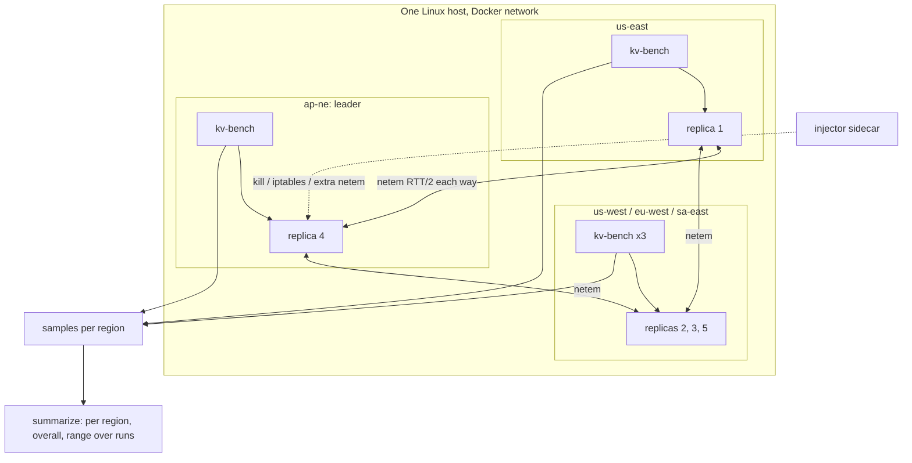

# Cross-Region Benchmark Harness - Plan

## Goal Capsule

- **Objective:** Anyone with one Linux host and Docker can reproduce, with one command, how QuePaxa, default etcd and tuned etcd behave for writes across five emulated regions when the leader's region fails, slows or jitters (p99, longest stall, client errors), and read the baseline in `docs/benchmarks.md`. Later engine work then has a number to beat.
- **Means:** a WAN mode of the existing etcd comparison harness: one container per region, per-destination `tc netem` delays from a five-region RTT matrix, a load generator per region on its local replica, leader pinned to the far region (KTD1, KTD2, KTD4).
- **Authority:** Requirements win on behavior; KTDs win on mechanism; units implement both and override neither.
- **Stop conditions:**
  - Stop and report if the host cannot hold the emulated RTTs within the R6 tolerance under load. Numbers from a mis-shaped network are worse than none.
  - Stop and report if etcd cannot be moved to the far member reliably (R2).
- **Execution profile:** kv-tokio flags (U1) and the shared-helper extraction (U2) first, then topology (U3), scenarios (U4), summaries (U5), baseline run and docs (U6).
- **Ships via:** pull requests to `main` under the repository's usual review (CI, Codex review).

---

## Product Contract

### Summary

Add a cross-region mode to `examples/kv-tokio/bench/etcd`. It starts five replicas of each system on one host, one per emulated region, shapes every replica-to-replica link with the round-trip time between their regions, and drives writes from every region at its local replica. It then injects faults into the leader's region and reports write latency, stalls and errors for QuePaxa, etcd with default timers and etcd tuned per its guide, over repeated runs. A first baseline goes into `docs/benchmarks.md`.

### Problem Frame

`STRATEGY.md` commits the library to cross-region availability and tail latency and names "cross-region tail latency" as a key metric, but nothing measures it. The current harness runs three replicas on a flat local network; its only distance scenario (`far-leader`) adds one uniform 50 ms delay to the leader. There QuePaxa leads (published p99: QuePaxa 13 ms, default etcd 243 ms, tuned etcd 1,126 ms; `docs/benchmarks.md`). That setup cannot show what matters across regions: with three replicas and a uniform delay, no leader is ever far from a real majority of asymmetric peers. The claim is untested, not supported. The simulator's `wan_leaders` example models placement but runs no real stack, no etcd, and no faults.

### Requirements

**Topology**

- R1. One command runs the cross-region comparison on five emulated regions, each replica-to-replica link delayed by half the RTT between their regions in each direction.
- R2. Each system runs with its leader in the region farthest from a majority. A no-fault control run per system puts it in the best-placed region.
- R6. Before measuring, the harness checks every replica pair's round-trip time against the matrix and aborts the run when any pair is off by more than 10% or 5 ms, whichever is larger.

**Workload and faults**

- R3. Writes come from a generator in every region, sent only to that region's replica, at a fixed total open-loop rate.
- R4. Scenarios: no fault, the leader's region killed, the leader's region partitioned from the rest, extra delay on the leader's links, and jitter with loss on the leader's links. Each fault starts and heals at fixed times, as in the existing harness.
- R5. QuePaxa runs with the WAN timer settings `quepaxa::Config` documents. Tuned etcd runs with heartbeat and election timeout set from the matrix's largest RTT per etcd's tuning guide. Default etcd runs with its defaults.

**Results**

- R7. For each system and scenario, the summary reports write p50, p99 and max, client errors, unanswered requests, longest stall and degraded time, overall and per region, and the region that led after the fault.
- R8. Each system and scenario runs several times (3 by default), and the summary reports the range across runs.
- R9. `docs/benchmarks.md` gains a cross-region section with a first baseline, the environment it ran on, and its limits as an emulation on one host.

**Compatibility**

- R10. The existing harness's scenarios, flags and outputs behave as before.

### Success Criteria

- The baseline shows, per scenario, whether QuePaxa's write p99 and longest stall beat tuned etcd's when the leader is far, and whether the flat far-leader result (QuePaxa ahead) holds with five asymmetric regions.
- A second full set of runs on the same host gives, per system and scenario, a p99 range overlapping the published one and the same QuePaxa-versus-tuned-etcd ordering on p99 and longest stall.

### Scope Boundaries

- No change to the QuePaxa engine. kv-tokio only gains flags that pass existing `Config` fields through (U1).
- No real cloud deployment. A multi-host or cloud run of the same scenarios is follow-up work.
- No new etcd API features in kv-tokio (`STRATEGY.md` Boundaries).
- No read workloads across regions. Reads are measured by the existing `mixed` scenario on a flat network.
- Considered and not built: a bandwidth cap per link. Control-plane writes are small, so latency and loss dominate. Revisit if payloads grow.

#### Deferred to Follow-Up Work

- A single source for the RTT matrix shared by `crates/quepaxa-sim/examples/wan_leaders.rs` and the harness (KTD2).
- The same scenarios on real regions.

---

## Planning Contract

### Key Technical Decisions

- KTD1. **Emulate regions on one host with per-destination `netem`.** Each replica container gets a classful root qdisc on `eth0` with one class per peer, selected by destination IP, and a `netem` qdisc per class delaying by RTT/2. Both ends shape their egress, so a round trip pays the full RTT. Jitter scenarios replace netem's internal time-ordered queue with a FIFO child so packets are not reordered, per `tc-netem(8)`. Chosen over real cloud regions for cost and reproducibility (session-settled: user-approved — chosen over cloud regions: cheaper and reproducible; noise is handled by repeats, R8).
- KTD2. **Use `wan_leaders`'s five-region matrix** (us-east, us-west, eu-west, ap-ne, sa-east). The harness carries its own copy with a comment naming its origin, so simulator and harness numbers are comparable (session-settled: user-approved — chosen over a uniform delay: only real asymmetry makes "far from a majority" happen). Unifying the two copies is deferred.
- KTD3. **Five replicas, one per region.** A majority is three, so the leader's distance to its two nearest peers decides commit latency. This is the effect the far-leader gap is about.
- KTD4. **Pin each system's leader.**
  - QuePaxa: `--leader-order` puts the far region's replica first.
  - etcd: after the cluster is ready, `etcdctl move-leader` transfers leadership to that member, and the harness confirms it before loading.
  - Rank regions by their second-nearest peer's RTT (the third-smallest entry in their matrix row, counting the zero self-entry), the distance a majority of three needs (KTD3). The far region has the largest; for this matrix that is ap-ne. The best-placed region has the smallest (us-east), used by R2's control.
  - QuePaxa's full `--leader-order` is the pinned region first, then the rest by ascending rank, so the leader after a fault is deterministic. etcd's next leader is whoever wins the election; the harness records each system's leader after the fault (R7) rather than controlling it (session-settled: user-approved — chosen over leaving placement to chance: the baseline must expose placement effects).
- KTD5. **Fair timers on both sides.**
  - kv-tokio gains `--retransmit-ms` and `--hedge-max-ms`. The harness passes 400 and 3000, the WAN values in the `quepaxa::Config` docs.
  - Tuned etcd gets heartbeat equal to the largest RTT and election timeout ten times it, per etcd's tuning guide.
  - The defaults of all three stay unchanged (session-settled: user-approved — chosen over defaults for QuePaxa: a 50 ms retransmit against 300 ms RTTs would measure a misconfiguration).
- KTD6. **A separate `wan.sh` beside `run.sh`, with shared helpers in `lib.sh`.** The flat-network harness stays as it is (R10), the new script stays under the file-size target, and helpers such as `sidecar`, `sleep_until` and the environment capture have one copy. Rejected: adding the WAN scenarios to `run.sh`, which would double its size and couple two topologies.
- KTD7. **Overall percentiles come from the merged per-request samples**, not from averaging per-region percentiles. Each generator already writes every request to a samples file (`kv-bench --samples`).

### High-Level Technical Design

Each run goes through these steps:

1. Start five replicas.
2. Shape the links.
3. Verify the RTTs (R6).
4. Pin the leader (KTD4).
5. Start the five generators on a shared start time.
6. Inject the fault and heal it.
7. Collect the samples.
8. Tear down.

Repeat for every run, scenario and system.

### Assumptions

- The host has at least 16 CPUs. It has 16, so replicas get two each and generators share the rest. At the default total rate (1000 writes/s), generator CPU is not the bottleneck; U6 checks this.
- `netem` per-destination shaping in containers needs `--privileged` sidecars, which the harness already uses for faults.
- Docker's bridge network adds well under 1 ms, small next to the matrix's 70–300 ms RTTs.

---

## Implementation Units

### U1. Timer flags for kv-tokio

- **Goal:** kv-tokio can run with WAN timers.
- **Requirements:** R5 (KTD5)
- **Dependencies:** none
- **Files:** `examples/kv-tokio/src/main.rs` (argument parsing and its tests)
- **Approach:** Add `--retransmit-ms` and `--hedge-max-ms`. They set `retransmit_interval` and `hedge_max` on the replica's `Config`, which already validates them. Without the flags nothing changes. Document both in the usage comment.
- **Patterns to follow:** `--snapshot-every` and `--leader-order` parsing; the existing `mod tests` in `main.rs`.
- **Test scenarios:**
  - Both flags given: the config carries 400 ms and 3000 ms.
  - Neither given: the config equals `Config::new`'s defaults.
  - `--hedge-max-ms 0`: startup fails with the config's validation error rather than running.
  - A non-numeric value: a parse error naming the flag.
- **Verification:** the tests pass; `kv-tokio --help` (usage comment) lists the flags.

### U2. Shared harness helpers

- **Goal:** helpers the flat and cross-region harnesses both need live in one file.
- **Requirements:** R10 (KTD6)
- **Dependencies:** none
- **Files:** `examples/kv-tokio/bench/etcd/lib.sh` (new), `examples/kv-tokio/bench/etcd/run.sh`
- **Approach:** Move the image build and pull, environment capture, `sidecar`, `cgroup_of`, `sleep_until` and cleanup into `lib.sh`, parameterized where they now read `run.sh`'s globals. `run.sh` sources it and is otherwise unchanged.
- **Execution note:** Run `run.sh --smoke` before and after. The summaries must have the same rows and columns.
- **Test expectation:** none (pure extraction). The smoke run before and after is the proof.
- **Verification:** `run.sh --smoke` completes and its summary matches the pre-change structure.

### U3. Five-region topology, link shaping and leader placement

- **Goal:** five replicas of either system start with shaped links, verified RTTs and the leader pinned.
- **Requirements:** R1, R2, R6 (KTD1–KTD5)
- **Dependencies:** U1, U2
- **Files:** `examples/kv-tokio/bench/etcd/wan.sh` (new), `examples/kv-tokio/bench/etcd/Dockerfile` (only if `iproute2`/`ping` are missing from the image)
- **Approach:**
  1. Hold the region names and RTT matrix as data at the top of the script, citing `wan_leaders.rs` (KTD2).
  2. Start five QuePaxa or etcd containers with fixed IPs and CPU sets. QuePaxa gets `--leader-order` and the U1 flags; etcd gets the timer pair for its variant (KTD5).
  3. In each replica's namespace, install an HTB (or prio) root with one class per peer IP, each with a `netem delay RTT/2` child, and an undelayed default class for everything else, including replies to the local generator.
  4. Ping every ordered replica pair and compare the median against the matrix, and ping each generator's local replica, which must stay under 1 ms (R6). Abort with the offending path on failure.
  5. For etcd, move leadership to the far member and confirm it via `endpoint status`. Retry a bounded number of times, then abort.
- **Technical design:** compute the far and best-placed regions and the full leader order from the matrix per KTD4, never hard-coded, so a changed matrix keeps R2's meaning. A `PLACEMENT=far|best` setting (default `far`) picks the pinned region.
- **Patterns to follow:** `start_quepaxa`, `start_etcd` and `ready` in `run.sh`; the `sidecar` netem use in `inject`.
- **Test scenarios:**
  - Smoke mode on the default matrix: every pair's measured RTT passes the R6 check.
  - Shaping deliberately skipped for one pair (a temporary debug switch, not shipped): the R6 check aborts the run and names that pair.
  - The etcd leader starts elsewhere: after the move the leader is the far member, and loading begins only then.
  - QuePaxa: the first leader is the pinned replica (seen in its `STATS` or decided-by counters).
  - `PLACEMENT=best`: both systems lead from us-east.
  - A generator-to-local-replica path accidentally shaped: the R6 check aborts and names it.
- **Verification:** a smoke run of the topology alone prints the RTT table and the confirmed leader for both systems.

### U4. Per-region load and leader-region faults

- **Goal:** each scenario runs with a generator per region and a fault on the leader's region.
- **Requirements:** R3, R4
- **Dependencies:** U3
- **Files:** `examples/kv-tokio/bench/etcd/wan.sh`, `examples/kv-tokio/src/bin/kv-bench/main.rs`, `examples/kv-tokio/src/bin/kv-bench/etcd.rs`
- **Approach:**
  1. Give kv-bench a `--seed` flag (default 1, so `run.sh` is unchanged per R10); its etcd mode now seeds arrivals and keys from it. Run five `kv-bench --protocol etcd` generators, each targeting its region's replica with its own seed. Each gets the total rate divided by five, a shared `--start-at`, `--fault-at` and its own samples file.
  2. Faults on the leader's region:
     - `crash`: kill the container.
     - `partition`: iptables drops between the leader and every peer, as in `run.sh`.
     - `slow`: add delay on the leader's classes, default +100 ms one-way.
     - `jitter`: jitter and loss on the leader's classes, defaults ±50 ms and 1% loss, with the FIFO child per KTD1.
  3. The leader region's generator keeps running during its region's fault. Its errors are part of what clients in that region see.
  4. After each faulted run's heal, record each system's leader region (QuePaxa `STATS`, etcd `endpoint status`) for R7.
  5. Run the no-fault scenario once more per system with `PLACEMENT=best` (R2).
  6. Repeat each run `REPEATS` times (default 3) with fresh containers.
- **Patterns to follow:** `faulted`, `inject` and `heal` in `run.sh`.
- **Test scenarios:**
  - `--smoke` with every scenario: each produces five samples files and a `.txt` summary line per generator.
  - `crash`: the four surviving regions' generators see completions after the fault. The crashed region's generator reports errors or unanswered requests, not a hang past the run's end.
  - `slow` and `jitter`: the healing step removes the extra netem, and a ping check after heal matches the matrix again.
  - `jitter`: the replicas' TCP reorder counters (`nstat` `TcpExtTCPSACKReorder` or similar) barely move; if they do, the FIFO child is not preventing reordering and the scenario must be reworked before it is published (see Risks).
  - Two generators given different seeds: their samples files differ in send times and keys; the same seed twice gives identical schedules.
- **Verification:** a smoke run of all scenarios completes for all three systems and leaves no containers or qdiscs behind.

### U5. Cross-region summary

- **Goal:** one markdown summary per results directory, with per-region and overall rows and the range across runs.
- **Requirements:** R7, R8 (KTD7)
- **Dependencies:** U4
- **Files:** `examples/kv-tokio/bench/etcd/summarize.sh` (or a sibling `summarize-wan.sh` if the shapes diverge), `examples/kv-tokio/src/bin/kv-bench/main.rs` (only if merging samples needs a helper)
- **Approach:**
  - Overall percentiles: compute from the concatenated samples of all regions for a run.
  - Longest gap and degraded time: take the worst region per run.
  - Across runs: report the median and min–max for each column.
  - Layout: an overall table with one row per system and scenario (including R2's control and the post-fault leader region), then a per-region table for every system and scenario (R7). The docs (U6) may show a subset; the generated summary keeps them all.
- **Patterns to follow:** the existing awk field extraction in `summarize.sh`; `timeline::longest_gap_us` and `degraded_us` semantics in `kv-bench`.
- **Test scenarios:**
  - Three runs with p99s of 100, 120 and 140 ms: the row shows median 120 and range 100–140.
  - One region's generator recorded no completions (the crashed one): its row shows errors and no latency, and overall percentiles use only completed requests.
  - A results directory from `run.sh`: the flat summary is produced exactly as before (R10).
- **Verification:** summarizing a smoke results directory yields well-formed tables. Merging samples by hand for one run gives the same p99.

### U6. Baseline run and documentation

- **Goal:** the first cross-region baseline is published with its environment and limits.
- **Requirements:** R9, success criteria
- **Dependencies:** U5
- **Files:** `docs/benchmarks.md`, `examples/kv-tokio/bench/etcd/README.md`
- **Approach:**
  1. Run the full suite on the quiet host (load average under 2 at start, as recorded in `env.txt`).
  2. Add an "Across regions" section to `docs/benchmarks.md`:
     - the matrix;
     - the leader placement;
     - the timer settings of all three systems;
     - the overall table;
     - the best-placed control rows;
     - the per-region table for the far-leader no-fault scenario and the leader-region crash;
     - a short reading that says plainly where QuePaxa loses.
  3. Name the limits: one host, emulated links, no bandwidth cap, Docker bridge.
  4. Document `wan.sh`, its environment variables and its runtime in the harness README.
- **Test expectation:** none (documentation and a measured run).
- **Verification:** a second full set of runs meets the reproduction criterion in Success Criteria, or the docs say where it did not and why.

---

## Risks & Dependencies

| Risk | Mitigation |
|---|---|
| Host noise from other tenants (load 5–9 seen this week) widens ranges until they say nothing | Repeats and ranges (R8); record load average per run; U6 runs only on a quiet host |
| `netem` per-class shaping misbehaves with Docker's veth or offloads | R6's pre-measurement check aborts the run; if checks fail persistently, stop (Goal Capsule) |
| `etcdctl move-leader` races with a fresh cluster's own election | Retry with a bound, confirm before loading (U3) |
| Jitter without reordering protection makes TCP look worse than the network it emulates; on current kernels netem may still time-sort before the FIFO child | FIFO child per KTD1; U4's reorder-counter check gates publishing the jitter scenario |
| 54 cluster runs (3 systems × (5 scenarios + 1 control) × 3 repeats) take long | Runtime documented; `--smoke` and scenario selection as in `run.sh` |

---

## Verification Contract

| Gate | Command | Applies to |
|---|---|---|
| Rust tests | `cargo test -p kv-tokio` | U1, U4 (`--seed`), U5 if `kv-bench` changes |
| Lint | `cargo clippy --workspace --all-targets --all-features`, `cargo fmt --all --check` | U1, U4, U5 |
| Shell | `shellcheck examples/kv-tokio/bench/etcd/*.sh` | U2–U5 |
| Flat harness unchanged | `examples/kv-tokio/bench/etcd/run.sh --smoke` | U2, U5 |
| Cross-region smoke | `examples/kv-tokio/bench/etcd/wan.sh --smoke` | U3–U5 |
| Baseline | `examples/kv-tokio/bench/etcd/wan.sh` on a quiet host | U6 |

---

## Definition of Done

- All units' verification passes. CI is green, and the Codex review is handled.
- `docs/benchmarks.md` has the cross-region baseline with ranges, environment and limits.
- No containers, networks or qdiscs remain after a run, including an aborted one.
- No debug switches or abandoned approaches remain in the diff.

---

## Sources & Research

- `examples/kv-tokio/bench/etcd/run.sh`: the topology, fault injection (`sidecar`, `inject`, `heal`) and timing (`--start-at`, `--fault-at`) this plan extends.
- `crates/quepaxa-sim/examples/wan_leaders.rs`: the five-region RTT matrix (KTD2).
- `crates/quepaxa/src/api.rs` `Config` docs: the WAN timer values, `retransmit_interval = 400 ms` and `hedge_max = 3000 ms` (KTD5).
- etcd tuning guide, https://etcd.io/docs/v3.6/tuning/: heartbeat about 0.5–1.5× RTT, election timeout at least 10× RTT (KTD5).
- `tc-netem(8)`, https://man7.org/linux/man-pages/man8/tc-netem.8.html: jitter reorders packets unless the internal queue is replaced with a FIFO; per-destination impairment via classful qdiscs and filters (KTD1).
- `docs/benchmarks.md` "Against etcd", leader faults table: the flat far-leader row (QuePaxa p99 13 ms, default etcd 243 ms, tuned etcd 1,126 ms) that the cross-region baseline extends.
- `examples/kv-tokio/src/bin/kv-bench/etcd.rs`: the etcd mode seeds its generator with a constant (`SplitMix(1)`), hence U4's `--seed`.
