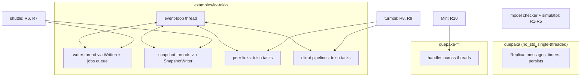

# Concurrency Assurance Across the Protocol and Runtime Layers - Plan

## Goal Capsule

- **Objective:** a change that breaks how QuePaxa or its reference runtime behaves under concurrency (wrong interleaving, lost wake-up, livelock, stuck connection) fails a check in CI before it ships, and every such failure replays deterministically.
- **Means:** extend the existing event-level model checker and simulator for the protocol (KTD1, KTD2), and add shuttle (KTD3) and turmoil (KTD4) harnesses for `examples/kv-tokio`, all behind test-only seams (KTD5).
- **Authority:** the Product Contract's requirements win on what must be checked; KTDs win on how; a unit overrides neither. `VERIFICATION.md` remains the single list of verification layers and must match what this plan adds.
- **Stop conditions:** stop and report if a new check finds a real bug in shipped code. Fix it under its own issue and PR, not inside this work. Also stop if a harness would require changing `quepaxa`'s public API or kv-tokio's runtime behavior.
- **Execution profile:** test and harness code only; no protocol or runtime behavior change. Units land independently, each with its own canary where it adds a guard.
- **Ships via:** one PR per phase (protocol, runtime, wiring), each green in CI and reviewed by the Codex and Copilot bots.

---

## Product Contract

### Summary

The plan has three parts. For the protocol, it widens the delay-bounded model checker and the simulator to the mechanisms that decide who proposes and when, adds operational liveness checks, and extends nightly runs. For `examples/kv-tokio`, it adds systematic checks of its thread handoffs (shuttle) and its async peer links and client pipelines (turmoil). For `quepaxa-ffi`, it checks the C ABI threading contract under Miri. Every new guard gets a seeded-bug canary.

### Problem Frame

QuePaxa's safety is proved and model-checked, but recent work concentrated on liveness mechanisms whose coverage is scenario tests and canaries: silent-leader takeover, deputies, rate-limited `ForwardAck`, the busy-leader hedge wait, the one-slot hedge cap and stepping aside. The model checker (`crates/quepaxa-sim/src/model.rs`) runs four scenarios with plain writes, one read and crashes. None of them reconfigures, and none is built to drive these mechanisms. Its liveness check only asks that depth-limited states settle under the default schedule.

Two timer busy-loops nearly shipped in this period, each a deadline left in the past. One was an `ack_due` entry left behind while stepped aside. The other was a hedge deadline the late filter skipped. A livelock (`suspect_target` returning early when the target was itself) was caught only by a lucky simulator seed.

`examples/kv-tokio` is the reference runtime that the etcd comparison measures. Its concurrency is real threads and tokio tasks, and it has no systematic checks at all. A replica cut off by a partition rejoined about 11 s after the heal, and only a Docker probe found it (#137). The writer-thread handoff, with `MAX_UNWRITTEN` backpressure and a `try_send` wake-up, is guarded only by example-based unit tests.

### Requirements

**Protocol layer**

- R1. The model checker explores schedules in which the liveness mechanisms actually fire: a silent or crashed leader with follower writes (suspicion, deputy, early takeover), a leader whose persists lag (stepping aside), hedging around a slow leader, and a linearizable read concurrent with hedged or handed-on writes. Agreement, ordered commits, `Committed` only for logged entries, and read coverage hold in all of them.
- R2. The model checker explores one membership change interleaved with writes, a crash and partitions, with the same invariants plus membership agreement. Per PR it exhausts the smallest such configuration; nightly adds deviations.
- R3. No replica fires timers repeatedly without progress. A deadline at or before `now` that persists across consecutive `handle_timeout` calls with no state change is reported as a timer storm, in the simulator and in the model checker.
- R4. Liveness is checked under faults, not only after them. While a majority is connected and its disks work, every write proposed at a replica in that majority commits within a stated virtual-time bound in the simulator.
- R5. Nightly runs the scenario suites (`leader_loss`, `disk_faults`) over many seeds, and the new model-check scenarios with an extra deviation, as `replica_sim` and `model_check` are run today.

**Runtime layer (`examples/kv-tokio`)**

- R6. The writer handoff is checked under systematically explored thread schedules: the event loop, the writer thread, `Written`, the jobs queue and the event queue. Under all of them, persists become durable and are reported in order, the event loop never deadlocks waiting on `MAX_UNWRITTEN`, a write failure stops the writer and releases any waiter, and the event loop eventually takes every report even when its event queue was full at the wake-up.
- R7. Concurrent snapshot saves never leave an older snapshot in place of a newer one.
- R8. Peer links are checked deterministically in simulated network and time:
  - a held or partitioned link is redialed within the stall limit plus backoff, and frames flow again after repair;
  - a large frame on a slow but draining link is delivered without a redial;
  - an unreachable peer's bounded queue drops frames instead of blocking the event loop.
- R9. A client connection that stops reading cannot take in more than `MAX_PIPELINE` plus two requests (the reply channel's capacity, one request held by the reader and one being sent), and replies keep request order, under simulated network delays.

**FFI**

- R10. The C ABI's threading contract is checked:
  - a handle used from another thread works;
  - distinct handles used concurrently from different threads do not interfere;
  - `qpx_last_error` is per thread.

  Miri runs these tests and reports any data race.

**Guarding the guards**

- R11. Each new check is shown to catch the bug class it targets by a seeded-bug canary in `verification/canaries.tsv`, and `VERIFICATION.md` lists each new layer.

### Success Criteria

- Each canary added by this plan is caught in CI, and planting each of these past bugs makes a new check fail:
  - the `suspect_target` self-target livelock;
  - the `ack_due` past deadline while stepped aside;
  - the skipped-late hedge deadline;
  - the kv-tokio whole-frame write deadline;
  - the kv-tokio stall redial removed (the #137 fix reverted).
- Per-PR CI time grows by at most about five minutes. The deeper exploration runs nightly.

### Scope Boundaries

- No change to the protocol, the replica's public API, or kv-tokio's runtime behavior; harnesses use test-only seams (KTD5).
- No new TLA+ modeling of timers or liveness: the TLA+ models deliberately omit timers and proposer choice (`VERIFICATION.md`, model-to-code table), and liveness here is checked operationally (KTD2).
- Not running a whole kv-tokio node under turmoil: its event loop and writer are blocking std threads (KTD4).
- loom is not adopted (KTD3).

#### Deferred to Follow-Up Work

- Fixes for bugs the new checks find: each goes to its own issue and PR, per the Goal Capsule stop condition.
- A multi-node kv-tokio cluster under turmoil, which would need an async event loop; reconsider only if the reference runtime is restructured.
- Concurrency checks for the etcd gRPC layer beyond the client-pipeline bound (R9); tonic owns that concurrency.

---

## Planning Contract

### Key Technical Decisions

- KTD1. **The protocol's concurrency is checked with the in-repo event-level model checker and simulator, not a thread-interleaving tool.** The `quepaxa` core is `no_std` and single-threaded (`&mut self`, no atomics, locks or `unsafe`); its concurrency is the order of messages, timers and persist completions. `model.rs` already enumerates those orders on the real replica, delay-bounded and sound within its bounds. loom or shuttle would see one thread.
- KTD2. **Liveness is checked operationally in the simulator and model checker, not in TLA+.** Timer storms (R3) and progress under a connected majority (R4) need real timers and virtual time, which only the Rust harnesses have. This keeps the TLA+ models' deliberate abstraction.
- KTD3. **shuttle for kv-tokio's thread handoffs, pinned to an exact version** (session-settled: user-directed — chosen over loom: loom's `mpsc` is a stub, so it could only check a hand-written stand-in for the jobs and event queues, not the real code; and over using both, which adds a second dependency and facade for one primitive). shuttle 0.9.10 implements `std::sync` including `mpsc::sync_channel`, `Condvar` and `Barrier`. Its random and PCT schedulers are not sound, so the smallest configurations also run under its DFS scheduler for exhaustive coverage (R6, R7). Failures replay from a printed schedule.
- KTD4. **turmoil for kv-tokio's async edges, as isolated components.** turmoil 0.7.2 runs tokio code over a simulated network and clock. It has `hold`/`release`, `partition`/`repair`, `crash`/`bounce` and TCP send-buffer capacity, which is backpressure. Hosts are single-threaded async, so the peer link functions (`outbound`, `inbound`) and the client pipeline run under turmoil, while the event-loop thread does not (R8, R9).
- KTD5. **Test-only seams, no behavior change.**
  - kv-tokio reaches `std::sync` and `std::thread` through one small facade module that maps to shuttle when kv-tokio's `shuttle` cargo feature is on. A feature rather than `RUSTFLAGS="--cfg shuttle"`: changing RUSTFLAGS rebuilds every dependency cold, `cfg(shuttle)` is not in the workspace's `check-cfg` list so `-D warnings` gates would fail, and `verification/canaries.sh` splits its environment column on whitespace.
  - The peer and client network functions take their connector and stream types as generics, so turmoil's types plug in from tests.
  - The writer handoff takes the disk through a trait so a fake disk can stand in; the unwritten-bytes limit becomes a `Node` field defaulting to `MAX_UNWRITTEN`; `Node::now` reads a clock the harness can fix (it reads the wall clock today, which shuttle does not control).
  - kv-tokio is binary-only (no library target), so the harnesses are in-crate test modules, like the existing ones in `node.rs` and `main.rs`, not integration tests under `tests/`.
  - Production builds compile to exactly what they do today.
- KTD6. **New dependencies are dev-dependencies of `examples/kv-tokio` only, exact-pinned, and pass `cargo deny`.** `quepaxa` and `quepaxa-ffi` gain none. shuttle releases about weekly, so the pin is bumped deliberately, never floated. Both crates are maintained under the tokio-rs and awslabs organizations.
- KTD7. **CI budget split.** Per PR, the new model-check scenarios run at their default deviations, shuttle runs bounded PCT iterations plus DFS on the minimal configurations, and turmoil runs fixed scenarios. Nightly adds deviations, seeds and iterations, sharded like the existing jobs.

### High-Level Technical Design

Which tool checks which concurrency:

The timer-storm rule (R3), as directional guidance:
- In the simulator, after each `handle_timeout`, compare the replica's fingerprint and `next_deadline` with the previous call. The same fingerprint with a deadline at or before `now` twice in a row is a storm, reported with the trace tail.
- In the model checker, which skips any state it has already visited, a storm is a single `Timeout` step that leaves the node's replica fingerprint unchanged with `next_deadline` still at or before `now`. It is checked when the step is applied, before visited-state pruning.

### Assumptions

- shuttle's `Condvar::wait` and `mpsc` `try_send`/`recv_timeout` behave as their std counterparts. The docs list these types, but the methods are not documented on the module pages. U6 confirms them first and falls back to the closest supported call if one is missing.
- turmoil's simulated TCP lets a write stall when the peer stops reading (`tcp_capacity`) and drops traffic on `partition`, which is enough to reproduce the #137 failure mode. Kernel retransmission backoff itself is not modeled.

### Risks & Dependencies

| Risk | Mitigation |
|---|---|
| Model-check state spaces explode with membership changes (R2) | Smallest cluster (3), one change, one deviation per PR. Nightly adds one. The checker already reports `exhausted`, so a run that hits its state budget is visible |
| The timer-storm detector flags a legitimate pattern, such as a deadline at `now` processed in two steps | Require no state change across two consecutive calls before reporting; a real storm repeats indefinitely |
| shuttle is not sound; a passing PCT run proves nothing | DFS on the minimal configuration (KTD3). Canaries prove each harness catches its target bug |
| Supply chain: two new dev-dependencies with transitive crates | Exact pins, `cargo deny`, dev-only, reviewed `Cargo.lock` diff (KTD6) |
| Seams leak into production behavior | Unit verification compares release builds: the facade and generics resolve to the std and tokio types with no runtime branch (KTD5) |

---

## Implementation Units

### Phase A: protocol layer

### U1. Timer-storm detector

- **Goal:** fail any simulator or model-check run in which a replica keeps re-firing a past deadline without progress.
- **Requirements:** R3, R11
- **Dependencies:** none
- **Files:** `crates/quepaxa-sim/src/lib.rs`, `crates/quepaxa-sim/src/model.rs`, `crates/quepaxa-sim/src/invariants.rs`, `crates/quepaxa-sim/tests/replica_sim.rs`, `verification/canaries.tsv`, `verification/canaries/hedge-deadline-left-in-the-past.patch`
- **Approach:**
  1. Plant the skipped-late hedge and the stepped-aside `ack_due` bugs against today's harnesses, and record whether the existing checks catch them, with which seeds: `Sim::run`'s same-time livelock check (100,000 events at one timestamp) and the model checker's `settle`.
  2. Add the detector per the timer-storm rule in High-Level Technical Design. It reports the storm when it starts, names the node and its deadline, and replaces the same-time counter in `Sim::run`, so one check owns this.
  3. A planted bug that neither harness reaches is a coverage gap for U2 or U4, not for this detector.
- **Patterns to follow:** existing invariant reporting in `invariants.rs`, with errors that carry the trace tail.
- **Test scenarios:**
  - A hostile `replica_sim` seed set passes with the detector on.
  - Planting a hedge deadline that stays in the past (the late filter skipping an entry while its timer still reports it) makes `replica_sim` fail with a timer-storm error. This is the new canary; its expected-failure pattern matches only the timer-storm error.
  - Planting the stepped-aside `ack_due` leftover makes the model checker or simulator fail.
  - A deadline exactly at `now` that is consumed by the next call is not reported.
- **Verification:** the detector runs in every existing simulator and model-check test without new failures, and both planted bugs are caught.

### U2. Model-check scenarios for the liveness mechanisms

- **Goal:** systematically explore suspicion, deputies, early takeover, stepping aside, hedging and reads against handed-on writes.
- **Requirements:** R1, R11
- **Dependencies:** U1
- **Files:** `crates/quepaxa-sim/src/model.rs`, `crates/quepaxa-sim/tests/model_check.rs`, `verification/canaries.tsv`
- **Approach:**
  1. Add the knobs these scenarios need to `ModelConfig`: proposals at followers after a leader crash, a persist-delay deviation that holds one replica's persist completions back (stepping aside needs a persist older than its threshold while others decide), and reads issued while writes are forwarded.
  2. Reuse the existing `Timeout` deviation, which already advances a node's clock to its next deadline ahead of pending deliveries. Change the default schedule only if a scenario cannot reach its mechanism within its deviation budget, since that would also change what the existing scenarios cost.
  3. Add scenarios:
     - leader crashed, two follower writes;
     - leader persists held, follower writes;
     - leader slow (its replies delayed) with one follower write hedged;
     - a read issued while a follower's write is forwarded to the deputy.
- **Patterns to follow:** the existing four scenarios and their `report.exhausted` assertions.
- **Test scenarios:**
  - Each new scenario is exhausted within its per-PR budget with all invariants holding.
  - The existing canaries `suspect-forwards-to-the-leader` and `stuck-leader-keeps-its-entries` are also caught by the model checker. Record whether they are.
  - Planting the `suspect_target` self-target early return (the livelock) makes a scenario fail through U1's detector or the settle check.
- **Verification:** the new scenarios reach states where suspicion, a deputy proposal, a hedge and a step-aside occurred (assert each was reached at least once), and every invariant holds.

### U3. Model-check scenario for a membership change

- **Goal:** explore one reconfiguration interleaved with writes, a crash and partitions.
- **Requirements:** R2, R11
- **Dependencies:** U2
- **Files:** `crates/quepaxa-sim/src/model.rs`, `crates/quepaxa-sim/tests/model_check.rs`, `verification/canaries.tsv`
- **Approach:** add a `reconfigure` entry to `ModelConfig` (one change to a new member set, possibly adding a spare replica). Extend the ledger checks with the membership agreement the random simulator already checks.
- **Patterns to follow:** `crates/quepaxa-sim/tests/replica_sim.rs` membership tests and their invariants.
- **Test scenarios:**
  - Replace one of three members with a spare while one write commits, with one crash-restart (crashes have their own budget) and one deviation, which may be a partition: exhausted, all invariants hold. Nightly adds a deviation.
  - The existing canaries `reconfiguration-takes-effect-early` and `reconfiguration-applied-twice` are caught by this scenario too.
- **Verification:** the scenario is exhausted within the per-PR budget, and the two canaries fail it.

### U4. Progress under a connected majority

- **Goal:** check liveness during faults, not only after them.
- **Requirements:** R4, R11
- **Dependencies:** U1
- **Files:** `crates/quepaxa-sim/src/lib.rs`, `crates/quepaxa-sim/src/invariants.rs`, `crates/quepaxa-sim/tests/replica_sim.rs`, `verification/canaries.tsv`
- **Approach:** while the fault schedule keeps a majority mutually connected, with working disks, for longer than a stated bound, every write proposed at a member of that majority must commit within the bound. Measure commit latency over hostile seeds first, then fix the bound as a multiple of the configured hedge cap and retransmit interval that the measurements clear with margin; takeover and catch-up also gate commits, so a bound derived from hedging alone would be flaky.
- **Test scenarios:**
  - Hostile seeds with partitions of a minority pass.
  - Planting a hedge that never fires (late entries never hedged) fails with the stuck proposal named.
  - A write proposed at the minority side is not held to the bound.
- **Verification:** the default and nightly `replica_sim` seed counts pass with the check on, and the planted bug is caught.

### U5. Nightly depth for the scenario suites

- **Goal:** run `leader_loss`, `disk_faults` and the new model-check scenarios deeper every night.
- **Requirements:** R5
- **Dependencies:** U2, U3
- **Files:** `.github/workflows/nightly.yml`, `crates/quepaxa-sim/tests/leader_loss.rs`, `crates/quepaxa-sim/tests/disk_faults.rs`
- **Approach:** shard by `QPX_SIM_SEEDS` the way the `replica_sim` nightly job does, and include the new model-check scenarios in the existing extra-deviation job.
- **Test expectation:** none, since this is CI wiring. Its first nightly run is the check.
- **Verification:** a manually dispatched nightly run completes, and its logs show the seed and deviation counts used.

### Phase B: runtime layer

### U6. shuttle harness for the writer handoff and snapshots

- **Goal:** check `Written`, the jobs queue and the event-queue wake-up under explored schedules, and concurrent snapshot saves.
- **Requirements:** R6, R7, R11
- **Dependencies:** none
- **Files:** `examples/kv-tokio/Cargo.toml`, `examples/kv-tokio/src/sync.rs` (new facade), `examples/kv-tokio/src/main.rs`, `examples/kv-tokio/src/grpc.rs`, `examples/kv-tokio/src/node.rs`, `examples/kv-tokio/src/storage.rs`, `examples/kv-tokio/src/node/shuttle_tests.rs` (new), `deny.toml` if needed, `verification/canaries.tsv`
- **Approach:**
  1. Route every `std::sync` and `std::thread` use in `main.rs`, `grpc.rs`, `node.rs` and `storage.rs` through `src/sync.rs`, which maps to shuttle under the `shuttle` feature (KTD5). The event queue is created in `main.rs` and held by `grpc.rs`, so all four must agree on its type.
  2. Gate the existing tests with `cfg(not(feature = "shuttle"))`: with the feature on, only the shuttle harness runs, and the tokio front ends compile but are not exercised.
  3. Add the disk trait, the unwritten-bytes field and the fixable clock from KTD5. The harness sets the limit to a few hundred bytes and fixes the clock.
  4. Drive the event loop's handoff logic (`flush`, `on_written`, `wait_for`) and `write_persists` from shuttle threads.
- **Execution note:** first confirm the shuttle methods named in Assumptions, before building the facade.
- **Patterns to follow:** the existing tests in `node.rs` (`every_report_reaches_the_replica_even_when_several_arrive_together`, `waiting_for_the_disk_ends_once_the_writer_catches_up`). The harness generalizes them across schedules.
- **Test scenarios:**
  - With two flushes and one `MAX_UNWRITTEN` wait, under DFS exhaustively: every persist is reported once and in order, and the waiter returns.
  - The event queue is full when the writer finishes (`try_send` fails as `Full`): the next event-loop pass still takes the report.
  - The fake disk fails the second append: the writer stops, the waiter is released, and no later persist is reported durable.
  - Two snapshot saves through 10 and 20 race (PCT and DFS): the file and `newest` end at 20, and the save through 10 returns `false` or completes first.
  - Canary: plant a missed notification (`advance` without `notify_all`). DFS finds the deadlock.
  - Sending to a peer whose bounded queue is full returns at once and drops the frame (`Node::send` uses `try_send`): a plain test with no peer task draining the queue.
- **Verification:** DFS on the minimal configurations completes; PCT runs its per-PR iterations; the canary is caught; release builds of kv-tokio are unchanged apart from the module path.

### U7. turmoil harness for peer links and client pipelines

- **Goal:** check redial, repair, slow large frames, bounded queues and the pipeline bound in simulated network and time.
- **Requirements:** R8, R9, R11
- **Dependencies:** none
- **Files:** `examples/kv-tokio/Cargo.toml`, `examples/kv-tokio/src/main.rs`, `examples/kv-tokio/src/turmoil_tests.rs` (new), `verification/canaries.tsv`
- **Approach:** make `outbound`, `inbound` and the client connection handler generic over their stream and connect types, so turmoil's `TcpStream` and `TcpListener` plug in (KTD4, KTD5). Each test hosts a sender and a receiver, and the turmoil sim manipulates the link between them.
- **Patterns to follow:** the existing `a_peer_connection_that_stops_draining_is_redialed`, `a_large_frame_to_a_slow_but_draining_peer_is_not_cut_off` and `a_client_that_never_reads_cannot_queue_unbounded_requests` tests. They stay as they are: they exercise the kernel's TCP, which turmoil does not model, and the turmoil versions are added alongside them.
- **Test scenarios:**
  - `hold` the link with frames queued: a second connection is accepted within the stall limit plus the maximum backoff, in simulated time.
  - `partition` for ten simulated seconds, then `repair`: frames sent after the repair arrive within about a second.
  - A 16 MiB frame over a link with low TCP capacity and steady draining is delivered on one connection.
  - A client sends three times `MAX_PIPELINE` requests and never reads replies: at most `MAX_PIPELINE` plus two are taken in, and replies come out in request order once it reads.
  - Canary: plant a whole-frame write deadline. The large-frame scenario fails.
  - Canary: remove the stall-based redial (the #137 fix). The `hold` scenario fails.
- **Verification:** all scenarios pass deterministically (the same seed gives the same trace); the canary is caught.

### U8. FFI threading contract under Miri

- **Goal:** check the C ABI's documented threading rules.
- **Requirements:** R10
- **Dependencies:** none
- **Files:** `crates/quepaxa-ffi/tests/c_abi.rs`, `verification/canaries.tsv`
- **Approach:** add tests using std threads. CI already runs `cargo miri test -p quepaxa-ffi`, which detects data races.
- **Test scenarios:**
  - A handle created on one thread is driven to a committed write on another.
  - Two handles on two threads at once each commit their own writes, and their metrics are independent.
  - A failing call on thread A sets `qpx_last_error` there; thread B's stays empty.
  - Canary: make the last-error slot process-global instead of thread-local. The per-thread test fails.
- **Verification:** the tests pass natively and under Miri.

### Phase C: wiring and documentation

### U9. CI wiring, canary list and VERIFICATION.md

- **Goal:** run the new checks at the right cadence and document them as verification layers.
- **Requirements:** R5, R11
- **Dependencies:** U1, U2, U3, U4, U6, U7, U8
- **Files:** `.github/workflows/ci.yml`, `.github/workflows/nightly.yml`, `VERIFICATION.md`, `verification/canaries.tsv`
- **Approach:** per KTD7, add a per-PR job for the shuttle and turmoil tests (the `shuttle` feature builds kv-tokio's test target), and nightly jobs with more iterations. Add `VERIFICATION.md` rows for each new layer, and update the model-to-code table for the mechanisms U2 and U3 now cover.
- **Test expectation:** none, since this is wiring and docs; U1-U8 carry the behavior.
- **Verification:** the per-PR increase stays within about five minutes on the PR that lands U9, and `verification/canaries.sh` catches every new canary.

---

## Verification Contract

| Gate | Command | Applies to |
|---|---|---|
| Workspace tests | `cargo nextest run --workspace --release` | all units |
| Model checker | `cargo nextest run --release -p quepaxa-sim --test model_check` | U1, U2, U3 |
| Simulator suites | `cargo nextest run --release -p quepaxa-sim` (with `QPX_SIM_SEEDS` raised locally for confidence) | U1, U4, U5 |
| shuttle harness | `cargo test -p kv-tokio --features shuttle --bin kv-tokio shuttle` | U6 |
| turmoil harness | `cargo test -p kv-tokio --bin kv-tokio turmoil` | U7 |
| FFI under Miri | `cargo miri test -p quepaxa-ffi` | U8 |
| Canaries | `RUSTFLAGS="-D warnings" verification/canaries.sh` | U1, U2, U3, U4, U6, U7, U8 |
| Lints and supply chain | `cargo clippy --workspace --all-targets -- -D warnings`, `cargo deny check` | U6, U7 |

---

## Definition of Done

- R1-R11 hold, each traced to a passing test or job above.
- Every new canary is listed in `verification/canaries.tsv` and caught with `-D warnings`.
- `VERIFICATION.md` lists the new layers, and its model-to-code table reflects what the model checker now covers.
- kv-tokio release builds behave as before: the seams add no runtime branch, and `examples/kv-tokio/bench/etcd/run.sh --smoke` passes.
- New dependencies are exact-pinned dev-dependencies of `examples/kv-tokio` and pass `cargo deny`.
- No abandoned harness experiments remain in the diff.

---

## Sources & Research

- Existing layers: `VERIFICATION.md`; model checker `crates/quepaxa-sim/src/model.rs` and `crates/quepaxa-sim/tests/model_check.rs` (four scenarios, no reconfiguration); nightly jobs in `.github/workflows/nightly.yml`.
- kv-tokio concurrency: `examples/kv-tokio/src/node.rs` (`Written`, `write_persists`, `maybe_snapshot`), `examples/kv-tokio/src/storage.rs` (`SnapshotWriter::newest`), `examples/kv-tokio/src/main.rs` (`outbound`, `inbound`, client pipeline).
- External, checked 2026-11-07:

  | Crate | Version | Released | Maintainer |
  |---|---|---|---|
  | shuttle | 0.9.10 | 2026-11-05 | awslabs |
  | turmoil | 0.7.2 | 2026-04-24 | tokio-rs |
  | loom | 0.7.2 | 2024-04-23 | tokio-rs |

  - shuttle: `std::sync` including `mpsc::sync_channel`, `Condvar` and `Barrier`; random, PCT and DFS schedulers; schedule replay; documented as not sound.
  - turmoil: `hold`/`release`, `partition`/`repair`, `crash`/`bounce`, `tcp_capacity`; single-threaded hosts.
  - loom: `loom::sync::mpsc` is a stub.
- Bugs that motivate the checks: #137 (rejoin after partition); the `suspect_target` self-target livelock and the stepped-aside `ack_due` and skipped-late hedge deadlines, all fixed during #132-#140.
