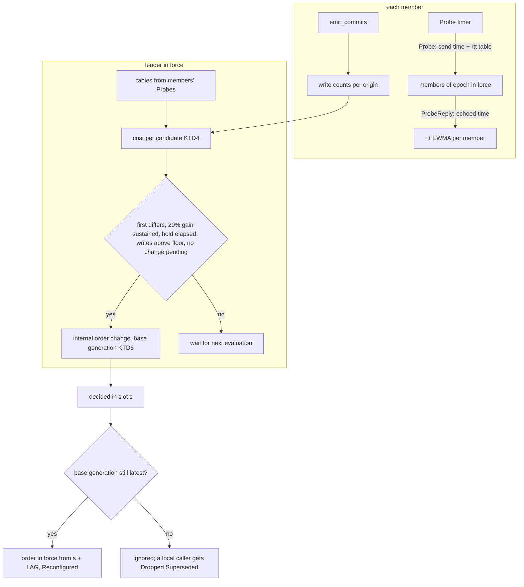
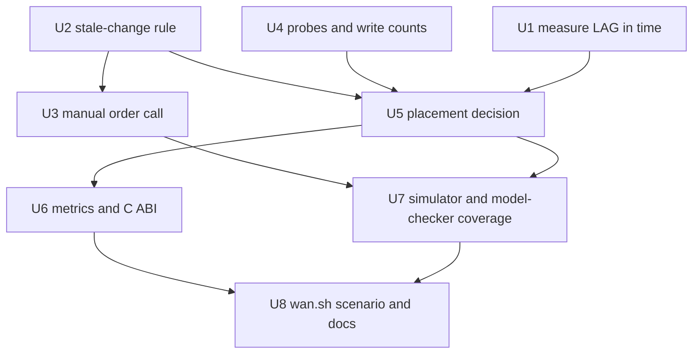

# Leader placement that follows latency and write load - Plan

## Goal Capsule

- **Objective:** a QuePaxa cluster spread across regions keeps its writes as fast as the best fixed leader choice would, without an operator choosing or revisiting that choice, and operators can see and override where the leader is.
- **Means:** the current leader ranks members by write-weighted commit latency and moves the leader through the leader-order change the log already decides (KTD1).
- **Authority:** the Product Contract wins on behavior, KTDs on mechanism; a unit overrides neither. Issues #147 (placement), #148 (metrics), #149 (manual call), #150 (measuring `LAG` in time) and #151 (verification) of milestone v0.7.0 are in scope; other milestones are not.
- **Stop conditions:** stop and report if a check finds a safety bug in shipped code beyond the stale-change gap R12 fixes; if U1 shows `LAG` slots take so long that R4's hold cannot be met at realistic write rates; or if keeping an idle cluster quiet (KTD3) proves impossible.
- **Execution profile:** core changes stay sans-IO, `no_std` and single-threaded ([ADR 0001](../adr/0001-sans-io-core.md)); wire, durable and snapshot formats change in place with no compatibility layer.
- **Ships via:** a PR per dependency layer, each green in CI (nightly assurance included for U2 and U7) and reviewed by the Codex bot.

---

## Product Contract

Product Contract preservation: changed R1, R5, R6, R9, R10 and added R12, AE7-AE12. R1 no longer prescribes that members report write rates (they come from the log); R5 widens the manual cool-down into one hold after any order change, including rotations; R6 and R10 follow the user's choices of 2026-11-07 (best-effort precedence with a visible outcome; scalar C ABI metrics only); R9 starts from the order in force; R12 and AE7-AE8 come from fixing the stale-change gap, also chosen that day; AE9-AE12 pin behavior research showed was undefined. Success Criteria now name where each example is checked (`wan.sh` for AE1-AE3, tests for the rest), with no change to what must hold.

### Summary

A placement policy built into the library, off unless the application enables it. Members exchange the round trips they measure; every member counts where decided writes originate. The current leader ranks every member by commit latency weighted by where writes originate, and reorders the leaders only when the gain is large and lasting. The same per-member data is exposed as metrics, operators get a call that changes only the leader order, and a change computed from an out-of-date order can no longer override a newer one.

### Problem Frame

Across regions, where the leader sits decides write latency more than anything the engine does per write. In the five-region `wan.sh` runs, the same load gives a write p99 of 655 ms with the leader in ap-ne and 339 ms with it in us-east (`docs/benchmarks.md`, "Across regions"). Today `leader_order` is set by hand from experience, it goes stale when write load moves between regions, and nothing shows an operator what each placement would cost. Raft libraries can move the leader only by hand or through elections. Elections on a jittery wide-area network are exactly the leader churn QuePaxa exists to avoid.

### Key Decisions

- **Built into the library, off by default, enabled by a configuration switch.** (session-settled: user-directed — chosen over exposing measurements only and over both: every service would otherwise write its own policy; off by default because it writes membership changes on its own and must first prove itself in `wan.sh`.) Governs R1, R9.
- **Objective: commit latency weighted by where writes originate.** (session-settled: user-directed — chosen over topology-only latency and over worst-region latency: it follows load, as STRATEGY track 1 names, and reduces to the geographic center when load is even.) Governs R3.
- **Conservative moves.** (session-settled: user-directed — chosen over aggressive tens-of-seconds moves and over a one-time choice: a move costs `LAG` slots, and churn on jittery links is what QuePaxa avoids.) Governs R4, R5.
- **The current leader decides, and a move is an ordinary leader-order change.** (session-settled: user-directed — chosen over deriving placement deterministically from measurements in the log, which would change the verified schedule, and over multi-leader slot assignment, which brings head-of-line blocking and new proofs.) Governs R6.
- **An operator's change takes precedence on a best-effort basis, and its outcome is visible.** (session-settled: user-directed — chosen over making placement changes always yield, which would need a longer delay window or overriding a decided change and so a change to the verified window rule.) Governs R6.
- **Metrics reach the C ABI only as scalar constants.** (session-settled: user-directed — chosen over new per-member C functions and over Rust-only: STRATEGY keeps `quepaxa-ffi` maintained, not extended.) Governs R10.
- **The stale-change gap is fixed in this work.** (session-settled: user-directed — chosen over a separate fix first: placement turns changes from rare operator events into routine ones, which makes the gap reachable.) Governs R12.
- **The whole order is ranked**, so the member that takes over when the leader goes silent (the deputy) is the second best. Governs R3.

### Requirements

**Measuring**

- R1. When placement is enabled, the leader learns each member's smoothed round trip to every other member and the rate of client writes originating at each member.
- R2. A member with no fresh round-trip samples is never placed first, so a crashed or partitioned member cannot be chosen.

**Deciding**

- R3. The leader ranks every member by the commit latency that member would give as leader: the sum, over members, of each member's write rate times its round trip to the candidate, plus the total write rate times the candidate's round trip to a majority. The order follows the ranking.
- R4. The leader proposes a new order only when the predicted improvement is at least 20% and has held for a sustained period of minutes.
- R5. No automatic move happens within a hold period after the order in force last changed, whether by an operator, by placement or by miss-based rotation.

**Moving**

- R6. A move is a leader-order change with the same members, decided in the log and in force `LAG` slots later. Placement proposes nothing while a change is pending or known to be in flight; if an operator's change still loses a race, its caller is told it did not take effect.
- R7. While the leader is down or has stepped aside, placement waits; miss-based rotation and silent-leader takeover keep the cluster writing as they do today.

**Operating**

- R8. One call changes only the leader order, for operators and for placement alike.
- R9. Enabling placement makes it own the leader order from then on, starting from the order in force.
- R10. The replica exposes each member's round trip and committed progress, the leader order and epoch in force, the share of slots decided on the fast path, and hedge, suspicion, step-aside and placement-move counts through the Rust API; the scalars among them also through the C ABI. Placement uses the same data.

**Correctness**

- R11. Leader-order changes, automatic or manual, keep every existing safety property. The simulator and model checker make random order changes and grow and shrink the member set during faults; each new check has a seeded-bug canary.
- R12. A membership or order change computed from an out-of-date configuration is ignored when it is decided, so it can never undo a newer change.

### Acceptance Examples

- AE1 (covers R3, R4). Five regions, leader in ap-ne, every region writing equally: within a few minutes the leader moves to the best-placed member and write p99 is at most 1.2 times that of the run pinned to us-east, with zero client errors.
- AE2 (covers R4). Once placement has converged, steady load and faults that add only jitter or 1% loss on the leader's links move the leader no further.
- AE3 (covers R3, R4). When writes shift for good from the regions near us-east to the regions near ap-northeast, the leader follows; a burst shorter than the sustained period does not move it.
- AE4 (covers R2, R7). With the leader's region crashed, placement proposes nothing, and takeover keeps the other regions writing as today. A member that is still unreachable is never ranked first.
- AE5 (covers R5, R8). After an operator moves the leader by hand, placement leaves the order alone until the hold ends, even if it would rank another member first.
- AE6 (covers R6). While an operator's membership change is pending, placement proposes nothing; it resumes once the change is in force.
- AE7 (covers R12). A change proposed before another change took effect is decided only after that change is in force: it is ignored, the member set stays as the newer change made it, and no member that already reported `Retired` comes back.
- AE8 (covers R6, R12). Placement's change is decided first and an operator's concurrent change after it: the operator's call reports that its change did not take effect, and the same change succeeds on retry.
- AE9 (covers R1, R4). With no client writes for many sustained periods, no probes, evaluations or proposals happen, and `next_deadline` returns none once in-flight work ends.
- AE10 (covers R2). A writing member that cannot reach a candidate makes that candidate ineligible, even if the candidate reaches a majority quickly.
- AE11 (covers R1, R9). With placement enabled on only some members, a leader that has it disabled proposes nothing, and an enabled leader proposes nothing while any writing member's round trips are unknown.
- AE12 (covers R3, R4). A change in ranking that leaves the first member unchanged proposes nothing.

### Success Criteria

- AE1-AE3 hold in `examples/kv-tokio/bench/etcd/wan.sh`, with results recorded in `docs/benchmarks.md`; AE4-AE12 hold in the unit and simulator tests U2-U7 name.
- Nightly assurance stays green with R11's and R12's checks, and every new canary is caught.

### Scope Boundaries

- Validation on real cloud regions (#159).
- Multi-leader slot assignment (each region leading a share of slots).
- Changing the miss-based rotation rule or `LAG` itself. If U1 shows `LAG` takes too long at low write rates, that becomes a separate decision, since `LAG` is part of the verified window rule.
- Reads are not counted in the write-origin weighting.
- No compatibility layer for the new messages and formats: mixed old and new versions are not supported.
- Considered and not built: running the placement policy inside the delay-bounded model checker. Its timers and minute-scale periods would make the state space useless there; the model checker covers order changes and stale-change rejection, the simulator and `wan.sh` cover placement. Evidence that would change this: a placement bug that only a schedule enumeration finds.
- Considered and not built: a guard and counter for a probe table larger than `max_message_bytes`. An oversized table is rejected by its receiver, which leaves round trips unknown and blocks moves, a safe outcome an operator sees as the leader staying put.
- Considered and not built: recording in the log whether a change was manual. R5's single hold after any order change makes the distinction unnecessary.

#### Deferred to Follow-Up Work

- Exposing per-member arrays through the C ABI (R10 keeps it to scalars).

### Dependencies / Assumptions

- `propose_reconfiguration` accepts the current members with a new `leader_order`, and the change takes effect `LAG` slots after the slot that decides it (`crates/quepaxa/src/replica/mod.rs:407-431`, `crates/quepaxa/src/schedule.rs:140-161`).
- Every order-only change bumps the epoch and emits `Action::Reconfigured` (`replica/log.rs:139-151`); applications see one reconfiguration event per move.
- The library stays sans-IO: measurements travel in the replica's own messages, decisions run in `handle_timeout`, and time comes only from the host's `Timestamp`.

### Sources / Research

- `docs/benchmarks.md`, "Simulated WAN placement" and "Across regions": placement alone moves p99 about 2x.
- [ADR 0004](../adr/0004-what-carries-over-from-raft.md): leader transfer and metrics redone for QuePaxa's per-slot preferred proposer.
- `VERIFICATION.md`, model-to-code table: leader rotation is modeled by the Verus port of `schedule.rs`, not by `Membership.tla`, which models member sets.

---

## Planning Contract

### Key Technical Decisions

- KTD1. **Placement lives in a new `replica/placement.rs` and proposes through an internal change hidden from the application.** The leader submits a `Kind::Reconfigure` entry through `submit`, exactly as the retirement barrier does (`replica/retire.rs:63-67`): it sits in `outstanding`, so `propose_reconfiguration`'s `proposed_here` check still reports `ReconfigurationPending` to a local operator, and it counts toward `max_outstanding_proposals` (on `Busy` it is retried at the next evaluation). Its id is held in a field like `retire_barrier`, and `emit_commits`, snapshot resolution and `fence` filter it, so it never reaches the application as `Committed` or `Dropped`. At most one placement change is in flight; a change counts as in flight from submission until it is decided, ignored, resolved by a snapshot or fenced, including while it sits in `self.batches`. `replica/mod.rs` (638 lines) and `codec.rs` (685) stay under the size cap.
- KTD2. **Round trips come from a new probe exchange; write rates come from the decided log.** `watch.reply` measures silence toward one forward target, includes the acknowledgement cooldown and jumps to slower samples (`replica/watch.rs:187-198`), so it is not a round trip. A member sends a `Probe` carrying its own send time and its current round-trip table to every member of the epoch in force; the receiver echoes the time in a `ProbeReply`. The sender keeps a symmetric integer EWMA (the `avg - avg/8 + sample/8` convention) per member; the leader keeps each member's latest table. Every replica counts `Kind::App` entries per `Entry.origin` as `emit_commits` applies them (`replica/log.rs:139-185`), so no member reports a write rate.
- KTD3. **Probe and evaluation timers run only while placement is enabled and writes were decided recently.** An idle cluster must go quiet: the model checker's `settle` (`crates/quepaxa-sim/src/model.rs`), `tests/membership_api.rs` and `tests/replica_api.rs` require `next_deadline` to return none without writes. Each firing moves its own deadline past `now`, or the timer-storm check fails (`crates/quepaxa-sim/src/lib.rs`, `check_timer_storm`).
- KTD4. **Integer cost and decision rules.** For candidate c with write counts w over the last window: `cost(c) = Σ_o w_o · rtt(o, c) + (Σ_o w_o) · quorum(c)`, where `quorum(c)` is the round trip from c to the member that completes a majority of the epoch in force with c itself counted at zero. A candidate is ineligible when any member with `w_o > 0` has no fresh `rtt(o, c)` (R2, AE10), when c's own table is stale, or when c is not a member. A move is proposed when the first-ranked member differs from the leader in force (AE12), `best · 5 <= current · 4` (R4's 20%) has held at every evaluation spanning the sustained period, the hold has elapsed (R5), and the total write count in the window is above a floor (AE9). Comparisons use integer arithmetic only, so core state stays hashable and deterministic.
  - `quorum(c)` uses only round trips that are individually fresh; if they do not complete a majority, c is ineligible. When the leader in force has no defined cost, nothing is proposed. Sums and products use `u128` with checked arithmetic, and an overflow skips the evaluation instead of saturating into a false gain.
  - The sustained window tracks one target member: it keeps running while that target keeps the 20% gain over the leader in force, even if another member briefly ranks above it, and restarts when the target changes, the leader in force changes, or the data goes stale.
  - The sustained window restarts when two consecutive evaluations are further apart than two probe intervals or when an evaluation falls below the write floor, so bursts separated by silence never add up (AE3).
  - A member that miss-based rotation or a step-aside removed from first place cannot be ranked first for one hold; the exclusion doubles each time placement restores it and it is demoted again, and resets once it has led for a full hold. Probes are ungated, so a leader with a stuck disk or an overloaded host still answers them quickly; without this rule placement and rotation would hand the lead back and forth (AE2).
- KTD5. **One locally measured hold after any order change.** Each replica records, in its own `Timestamp`s, when the order in force last changed: when it applies the first slot of a new order (an epoch's `from`, or a rotation's start), not when `Action::Reconfigured` arrives at decision time. Nothing about timing is persisted: a restarted replica, or one that installed a snapshot, treats the latest change as having just taken effect, and a new leader starts its sustained window from its own evaluations. The order a cluster starts with is not a change: a replica whose log and snapshot hold no change or rotation applies no hold, so AE1's first move needs only the sustained period. Configuration has two knobs, the sustained period (default about 3 minutes) and the hold (default about 10 minutes); the 20% threshold is a constant.
- KTD6. **Changes carry the order generation they were computed from; a stale one is ignored when decided, which replaces `Schedule::settled`.** The generation counts every change to the leader order a replica will apply: each membership or order change and each counted rotation (rotations do not bump the epoch, `schedule.rs` `observe`). The `Kind::Reconfigure` payload gains the base generation before the order (`schedule.rs`, `encode_order`/`decode_order`). `Schedule::reconfigure` ignores a change whose base generation is not the latest, in addition to the existing `slot < epoch_from` rule, which stays. So an in-flight change cannot undo a rotation or a newer change, and a second copy of an applied change carries a stale base, which lets the unbounded `settled` list and its snapshot encoding go away (`schedule.rs:141-148`, `178-208`). Bump `core_state::VERSION` (`core_state.rs:13`). Port the change to `verification/verus/schedule.rs` and model it in `Membership.tla` (a change records the change count it saw; a stale one installs nothing).
- KTD7. **A change proposed through `propose_reconfiguration` or `propose_leader_order` that is decided but ignored reports `Action::Dropped` with a new `DropReason::Superseded`.** Placement's internal changes stay silent (KTD1). A local change resolved by installing a snapshot cannot tell whether it was applied, because the decided entry also enters `dedup` when it is ignored (`replica/snapshot.rs`, `replica/log.rs:144-156`): it reports `Dropped` with a new `DropReason::Unresolved` instead of today's `Committed`, and the caller checks the order in force. Both reasons reach the C ABI action path (`crates/quepaxa-ffi/src/actions.rs`, today mapping every non-`Fenced` reason to 0) and kv-tokio's client replies, distinct from the fenced "outcome unknown". It replaces today's silent `Committed`-without-`Reconfigured` (R6, AE8). `Dropped` already means "will not be reported again"; the variant is a breaking API change recorded in CHANGELOG.
- KTD8. **The configuration switch is per member; only an enabled leader proposes.** (Product Key Decision 1, governs R1, R9.) Partial enablement fails safe: disabled members neither probe nor answer probes, so an enabled leader sees their round trips as unknown and, by KTD4, ranks no candidate eligible while they write (AE11). The guide requires enabling it on every member.
- KTD9. **The manual call validates against the order in force at `committed` and shares KTD6's base epoch.** `propose_leader_order(now, order)` takes a permutation of the members in force, returns a `ProposalId` like `propose_reconfiguration`, and reports `Reconfigured` or `Dropped(Superseded)` (R8). kv-tokio exposes it as a `LEADERS <ids>` command next to `RECONFIGURE` (`examples/kv-tokio/src/main.rs:285-286`). With placement enabled, a membership change given no `leader_order` keeps the order in force for the members that stay and appends new members at the end, instead of falling back to ids (`replica/mod.rs`, `by_id`), so a routine membership change does not reset the leader (R9).

### High-Level Technical Design

Measurement and decision, on every replica with placement enabled while writes flow:

Stale-change rule (directional): `reconfigure(slot, change)` applies only if `change.base == generation` and `slot >= epoch_from`; applying a change or counting a rotation bumps the generation, so any other copy or concurrent change built on an older one is ignored.

### Assumptions

- The leader learns other members' tables only from their probes; a member whose probes to the leader are lost for a whole sustained period is treated as stale, which blocks moves rather than misplacing the leader.
- Probe cadence and the write floor are tuning values chosen in U4 and U5 and recorded in `crates/quepaxa/docs/tuning.md`.
- Clients submit writes at their nearest replica, as `wan.sh`'s generators do. Clients that send every write to the current leader make every write originate there, so placement never moves; the tuning guide states this.

### Sequencing

---

## Implementation Units

### U1. Measure how long LAG slots take in time

- **Goal:** know how long an order change takes to take effect at realistic write rates, before fixing KTD5's defaults (#150).
- **Requirements:** R4, R5; Scope Boundaries ("Changing ... `LAG`").
- **Dependencies:** none.
- **Files:** `crates/quepaxa-sim/tests/leader_loss.rs` (or a sibling `crates/quepaxa-sim/tests/order_change.rs`), `docs/benchmarks.md`.
- **Approach:**
  1. In the WAN simulator setup (`leader_loss.rs` matrix, `links`), propose an order-only change at several write rates (idle, 1, 10, 100 and 1,000 writes per second) and record the virtual time from the decision to the change being in force.
  2. Repeat on a LAN setup.
  3. Record the table in `docs/benchmarks.md` and state whether a 3-minute sustained period and 10-minute hold are sound against it.
- **Execution note:** a measurement, not a feature; it may stop the plan per the Goal Capsule.
- **Test scenarios:**
  - An idle cluster takes the change into force through stalled slots, within the time the measured table reports.
  - At 100 writes per second across five regions, the change is in force within the reported time.
- **Verification:** the table is in `docs/benchmarks.md`, and KTD5's defaults are confirmed or adjusted in this plan before U5 starts.

### U2. Ignore changes computed from an out-of-date order generation

- **Goal:** no membership or order change can undo a newer one, and `Schedule::settled` stops growing (KTD6, KTD7).
- **Requirements:** R12, R6; AE7, AE8.
- **Dependencies:** none.
- **Files:** `crates/quepaxa/src/schedule.rs`, `crates/quepaxa/src/core_state.rs`, `crates/quepaxa/src/replica/mod.rs`, `crates/quepaxa/src/replica/log.rs`, `crates/quepaxa/src/api.rs` (`DropReason`), `crates/quepaxa/src/replica/snapshot.rs`, `crates/quepaxa-ffi/src/lib.rs` (drop reason constants), `crates/quepaxa-ffi/src/actions.rs`, `examples/kv-tokio/src/node.rs`, `examples/kv-tokio/src/client.rs`, `crates/quepaxa-ffi/include/quepaxa.h`, `verification/verus/schedule.rs`, `verification/tla/Membership.tla`, `verification/tla/MembershipProof.tla`, `verification/tla/MembershipRecover.tla`, `verification/tla/ReadsProof.tla`, `verification/tla/run.sh` (seeded bug), `crates/quepaxa/tests/membership_api.rs`, `verification/canaries.tsv`, `verification/canaries/stale-change-applied.patch`, `verification/canaries/reconfiguration-applied-twice.patch`, `CHANGELOG.md`, `crates/quepaxa/docs/membership.md`.
- **Approach:**
  1. Track the order generation in `Schedule` (KTD6) and encode the base generation with each change; `propose_reconfiguration` stamps the latest generation it knows.
  2. `reconfigure` ignores a stale base; remove `settled` and its encoding; bump `core_state::VERSION`. Retarget the `reconfiguration-applied-twice` canary at the base-generation check, keeping its "late duplicate" expectation.
  3. `emit_commits` reports `Dropped(Superseded)` for a local change it ignored, and snapshot resolution reports `Dropped(Unresolved)` for a local change it cannot classify (KTD7); carry both reasons through the C ABI action path and kv-tokio's replies.
  4. Port the generation counter to the Verus schedule (today "the epoch counter is not ported", `verification/verus/schedule.rs`) and prove that it only grows, that a change with a stale base installs nothing, and that each change installs at most once; keep the window rule and its seeded bugs.
  5. In `Membership.tla`, record each change's base and add an invariant stating that every installed change's base equalled the change count when it was decided, so a stale install violates a property directly (`ViewAgree` alone does not catch it); add the matching seeded bug.
  6. Re-prove `ViewAgree`, recovery and `FoldedFixed` under the new guard in `FoldStep` (`MembershipProof.tla`, `MembershipRecover.tla`, `ReadsProof.tla`); `prove.sh` refuses to run unproved modules.
  7. Correct `propose_reconfiguration`'s doc, which today promises that a concurrent change decided after another is always ignored.
- **Execution note:** start with a failing schedule test that applies a stale change decided after the previous one took effect.
- **Patterns to follow:** `schedule.rs` unit tests (where `reconfiguration-applied-twice` is caught), `retire.rs` for local id handling.
- **Test scenarios:**
  - Covers AE7. Change A (remove E) decided at slot a; change B, built on the epoch before A, decided at slot a + LAG + 5: B is ignored, the members stay without E, and no `Reconfigured` is emitted for B.
  - A change built on the latest generation, decided after the previous change is in force, applies and bumps the epoch and the generation.
  - A change proposed before a rotation is counted and decided after it is ignored.
  - Two copies of the same change decided in one slot and in two slots: the first applies, the second is ignored (replaces the `settled` test).
  - Covers AE8. A local change ignored at decision yields `Dropped { reason: Superseded }`, not `Committed`.
  - A snapshot taken after several changes restores the same schedule, and a snapshot with the old version is rejected.
  - A replica whose local change was decided and ignored elsewhere, and that then installs a snapshot covering it, reports `Dropped { reason: Unresolved }`, never `Committed`.
  - A snapshot installed between a change's decision and its effect, followed by another copy of that change being decided, leaves the change applied once.
  - Over the C ABI, `Superseded` and `Unresolved` arrive as their own reason constants.
- **Verification:** schedule and membership tests pass; `verification/verus/prove.sh` proves the port and catches its seeded bugs; `verification/tla/run.sh membership bugs` passes with the new seeded bug caught; `verification/tla/prove.sh --cleanfp` proves every obligation; both canaries are caught.

### U3. Change only the leader order with one call

- **Goal:** operators and placement change the leader order through one call (KTD9).
- **Requirements:** R8, R6; AE5, AE8.
- **Dependencies:** U2.
- **Files:** `crates/quepaxa/src/replica/mod.rs` (or `replica/placement.rs` once U4 creates it), `crates/quepaxa/tests/membership_api.rs`, `crates/quepaxa-ffi/tests/c_abi.rs`, `examples/kv-tokio/src/main.rs`, `examples/kv-tokio/src/node.rs`, `crates/quepaxa/docs/membership.md`.
- **Approach:**
  1. Validate the order as a permutation of the members in force at `committed`, then submit through the same path as `propose_reconfiguration`.
  2. Add no C function: `qpx_propose_reconfiguration` with the current members and a new order already makes an order-only change, which keeps the C ABI to R10's scalar additions. Document that use in the C header comment and the membership guide.
  3. Add `LEADERS <ids>` to kv-tokio.
  4. With placement enabled, give a membership change without an order the in-force order of the staying members, new members last (KTD9).
- **Test scenarios:**
  - An order naming exactly the members in force is accepted and in force `LAG` slots after its decision.
  - An order missing a member, adding a non-member or repeating one is rejected with `InvalidConfig`.
  - A call while a change is pending returns `ReconfigurationPending`.
  - With placement enabled, adding a member without an order leaves the leader unchanged.
  - Over the C ABI, `qpx_propose_reconfiguration` with the same members and a new order moves the leader in a three-member cluster.
- **Verification:** the membership API and C ABI tests pass.

### U4. Probe round trips and count write origins

- **Goal:** every enabled member measures round trips to the members in force, the leader holds every member's table, and every replica counts writes per origin (KTD2, KTD3, KTD8).
- **Requirements:** R1, R2; AE9, AE11.
- **Dependencies:** none.
- **Files:** `crates/quepaxa/src/codec.rs`, `crates/quepaxa/src/replica/messages.rs`, `crates/quepaxa/src/replica/placement.rs` (new), `crates/quepaxa/src/replica/placement_tests.rs` (new), `crates/quepaxa/src/replica/mod.rs`, `crates/quepaxa/src/replica/proposing.rs` (timers), `crates/quepaxa/src/replica/log.rs`, `crates/quepaxa/src/api.rs` (switch and periods), `crates/quepaxa/src/replica/tests.rs` (`arb_body`).
- **Approach:**
  1. Add `Probe` and `ProbeReply` to `Body` at every match site in `codec.rs`, with golden-bytes and round-trip tests; send them with the ungated `send`.
  2. A table carries at most the members of the epoch in force. A table too large for `max_message_bytes` is rejected by its receiver, so its round trips stay unknown and placement makes no move; no separate guard is built.
  3. Keep round trips and their freshness in a `#[cfg_attr(feature = "model", derive(Hash))]` struct; count `Kind::App` origins in `emit_commits`.
  4. Arm the probe timer only while enabled and writes were decided within the last window; disabled members ignore probes.
- **Execution note:** implement test-first from `placement_tests.rs`, driving `handle_timeout` the way `watch_tests.rs` does.
- **Patterns to follow:** `Body::ForwardAck` (#132) for a new message kind; `watch.rs` for per-member state; the integer EWMA in `log.rs` (`observe_latency`).
- **Test scenarios:**
  - Two members exchanging probes converge to the injected round trip within a few samples, and a slower outlier moves the average by one eighth, not to the outlier.
  - The leader stores a follower's table from its probe; a table older than the freshness bound counts as unknown.
  - Covers AE9. With no writes decided for a window, no probe is sent and `next_deadline` returns none.
  - Covers AE11. A member with placement disabled sends no probe and ignores one it receives.
  - Write counts per origin match the decided entries, and reads do not count.
  - A replica restarted with a new incarnation starts with empty tables.
- **Verification:** the codec tests, the new unit tests, and the existing quiescence tests (`replica_api.rs`, `membership_api.rs`) pass.

### U5. Rank members and move the leader

- **Goal:** an enabled leader proposes the best order when KTD4's conditions hold and never otherwise (KTD1, KTD4, KTD5).
- **Requirements:** R2, R3, R4, R5, R6, R7, R9; AE1-AE6, AE10, AE12.
- **Dependencies:** U1 (defaults), U2, U4.
- **Files:** `crates/quepaxa/src/replica/placement.rs`, `crates/quepaxa/src/replica/placement_tests.rs`, `crates/quepaxa/src/replica/retire.rs` (shared internal-proposal handling), `crates/quepaxa/src/replica/log.rs`, `crates/quepaxa/src/api.rs`, `crates/quepaxa/docs/tuning.md`, `crates/quepaxa/docs/membership.md`.
- **Approach:**
  1. Evaluate at each probe round on the leader in force only (`leads_now`), and not while stepped aside, while a change is pending in the schedule, or while a `Kind::Reconfigure` sits in `pending`, `relayed` or `batches` (R6, R7, KTD1).
  2. Compute KTD4's cost per member, rank, and track how long the gain has held.
  3. Record when the order in force last changed, from `applied_schedule`, for the hold (KTD5).
  4. Submit the move as an internal change (KTD1) with KTD6's base epoch.
- **Execution note:** test-first in `placement_tests.rs` with injected tables and write counts; no network needed.
- **Technical design:** directional. `evaluate(now)` returns either nothing or an order; the caller submits it. Keeping the decision a pure function of tables, counts, schedule and times makes it testable without a cluster.
- **Test scenarios:**
  - Covers AE1. Five members with the `wan_leaders` round trips and equal writes rank us-east first, with ap-ne as the leader in force: after the sustained period, one internal change is submitted.
  - A gain of 19% never proposes; a gain of 20% held for the whole period proposes once.
  - Covers AE3. The gain disappears for one evaluation inside the period: the window restarts.
  - Covers AE3. Two bursts separated by silence, together spanning the period, propose nothing.
  - Covers AE2. A member rotated out of first place is not ranked first during the next hold; restored and demoted again, it is excluded for twice as long.
  - Covers AE5. An order change took effect 5 minutes ago with a 10-minute hold: no proposal although the gain holds.
  - Covers AE12. Only positions 2..n change: no proposal.
  - Covers AE10. A writing member has no fresh round trip to the best candidate: that candidate is skipped and the next eligible one is ranked.
  - Covers AE6. A `Kind::Reconfigure` sits in the leader's relayed queue, or in a batch still being decided: no proposal.
  - Two members alternate in first place while each keeps a 20% gain: the move happens when the tracked target has held its gain for the whole period, and a member that beats the leader in force only once is never chosen.
  - A candidate whose fresh round trips do not complete a majority is ineligible; with the leader in force's cost undefined, nothing is proposed.
  - Covers AE4. The leader in force is not this replica, or this replica stepped aside: no evaluation.
  - Total writes below the floor: no proposal.
  - The internal change's id never appears in `Committed`, `Dropped` or `Busy`.
- **Verification:** the unit tests pass and the simulator run in U7 converges.

### U6. Expose placement and per-member metrics

- **Goal:** operators see where the leader is and why (R10).
- **Requirements:** R10.
- **Dependencies:** U5.
- **Files:** `crates/quepaxa/src/api.rs` (`Metrics`), `crates/quepaxa/src/replica/mod.rs` (a per-member view), `crates/quepaxa/src/replica/watch.rs` (suspicion counter), `crates/quepaxa/src/replica/messages.rs` (per-peer committed index), `crates/quepaxa-ffi/src/lib.rs`, `crates/quepaxa-ffi/include/quepaxa.h`, `crates/quepaxa-ffi/tests/c_abi.rs`, `examples/kv-tokio/src/node.rs` (`STATS`), `examples/kv-tokio/bench/etcd/wan.sh` (leader detection), `crates/quepaxa/docs/tuning.md` ("Observability").
- **Approach:**
  1. Add scalar counters and gauges (suspicions, placement moves, epoch in force, the position of this replica in the order in force) to `Metrics`; `hedged`, `stepped_aside`, `fast_path_decisions` and `slots_decided` already exist and carry R10's remaining scalars (the fast-path share is their ratio).
  2. Add a read-only per-member view (round trip, committed index from message envelopes, freshness) and the order in force, in the Rust API only.
  3. Add `QPX_METRIC_*` constants for the scalars, bump `QPX_ABI_VERSION_MINOR`, and regenerate the header.
  4. Print the order in force in kv-tokio's `STATS`, and let `wan.sh` read the leader from it instead of sampling fast-path decisions.
- **Test scenarios:**
  - A suspicion increments the suspicion counter once per suspected target.
  - After a placement move takes effect, the epoch gauge advances by one and the move counter by one.
  - The per-member view reports the committed index a peer's last message carried.
  - Over the C ABI, every new metric constant is readable (extend `metrics_are_readable_over_the_abi`).
- **Verification:** unit and C ABI tests pass, the header matches cbindgen, and `wan.sh` reports the leader from `STATS`.

### U7. Cover order changes in the simulator and model checker

- **Goal:** order changes, member-set growth and shrinkage, and placement under faults are checked continuously (R11, R12).
- **Requirements:** R11, R12; AE2, AE4, AE7.
- **Dependencies:** U3, U5.
- **Files:** `crates/quepaxa-sim/src/config.rs`, `crates/quepaxa-sim/src/lib.rs`, `crates/quepaxa-sim/src/model.rs`, `crates/quepaxa-sim/tests/replica_sim.rs`, `crates/quepaxa-sim/tests/model_check.rs`, `crates/quepaxa-sim/tests/placement.rs` (new), `verification/canaries.tsv`, `verification/canaries/*.patch`, `VERIFICATION.md`.
- **Approach:**
  1. In the simulator's `reconfigure`, sometimes keep the member set and shuffle the order, and draw the new size from one up to nodes plus spares.
  2. Add a write-origin weight knob (with a switch time) and a placement-enabled WAN test next to `leader_loss`.
  3. In the model checker, add an order-only change scenario and a stale-change scenario (a change proposed before another takes effect, decided after).
  4. Add canaries: stale change applied (if U2's canary does not cover the simulator), a stale member ranked first, and the hold ignored.
- **Test scenarios:**
  - Covers AE7. The model checker scenario with a stale change is exhausted with membership agreement holding.
  - Hostile membership seeds with random orders and sizes stay safe and converge.
  - Covers AE2, AE4. The placement WAN test converges from ap-ne within the bound; afterwards, under jitter and while the leader's region is down, placement makes no proposal. Rotations the protocol makes on its own are counted separately and do not fail the test.
  - When rotations recur faster than the hold, placement proposes nothing and resumes once the leader is stable for a hold.
  - Covers AE2. A leader with a slow disk and healthy links is moved back at most once after rotation demotes it.
  - Each canary fails its check with its expected message.
- **Verification:** `replica_sim`, `model_check` and the new placement test pass per PR; the nightly extra-deviation run stays exhaustive; `verification/canaries.sh` catches every new canary.

### U8. Measure placement in wan.sh and document it

- **Goal:** show AE1-AE3 on the five-region harness and document the feature (Success Criteria).
- **Requirements:** R3, R4; AE1, AE2, AE3.
- **Dependencies:** U6, U7.
- **Files:** `examples/kv-tokio/bench/etcd/wan.sh`, `examples/kv-tokio/src/bin/kv-bench/main.rs`, `examples/kv-tokio/src/main.rs` (placement flags), `docs/benchmarks.md`, `crates/quepaxa/docs/tuning.md`, `crates/quepaxa/docs/membership.md`, `VERIFICATION.md`, `CHANGELOG.md`, `README.md` (drop "automatic latency-based leader tuning" from "Not supported").
- **Approach:**
  1. Add a `placement` scenario to `wan.sh`: minutes long, leader starting in ap-ne, optional per-region rates, and a rate shift.
  2. Give `kv-bench` a rate change after a given time.
  3. Record the results in `docs/benchmarks.md` against the pinned us-east and ap-ne runs.
- **Test expectation:** the `wan.sh` runs are the check; no new unit tests beyond the flags' parsing.
- **Verification:** AE1-AE3 hold in three runs each, recorded with their raw result directories.

---

## Verification Contract

| Gate | Command | Applies to |
|---|---|---|
| Workspace tests | `cargo nextest run --workspace --no-fail-fast` | all |
| Model checking | `cargo nextest run --release -p quepaxa-sim --test model_check` | U2, U7 |
| Simulator | `cargo nextest run --release -p quepaxa-sim` (raise `QPX_SIM_SEEDS` locally) | U1, U7 |
| Verus | `verification/verus/prove.sh` | U2 |
| TLA+ | `TLA_SECONDS=120 verification/tla/run.sh membership bugs` | U2 |
| TLAPS | `verification/tla/prove.sh --cleanfp` | U2 |
| Canaries | `RUSTFLAGS="-D warnings" verification/canaries.sh` | U2, U7 |
| C ABI | `cargo miri test -p quepaxa-ffi`; header regenerated with cbindgen and unchanged; `nm` symbols match `crates/quepaxa-ffi/symbols.txt` | U2, U6 |
| Lint and supply chain | `cargo clippy --workspace --all-targets -- -D warnings`, `cargo fmt --all --check`, `cargo deny check`, `cargo doc --workspace --no-deps` with `-D warnings` | all |
| no_std | `cargo build -p quepaxa --target thumbv7em-none-eabihf` | U2, U4, U5 |
| Cross-region | `examples/kv-tokio/bench/etcd/wan.sh` with the `placement` scenario | U8 |

---

## Definition of Done

- R1-R12 hold, each traced to a passing test, check or recorded `wan.sh` run.
- AE1-AE12 are covered as the units state, and the Success Criteria are met.
- Every new canary is listed in `verification/canaries.tsv` and caught; the Verus and TLA+ seeded bugs still fail their checks.
- `next_deadline` returns none in an idle cluster with placement enabled.
- CHANGELOG records the breaking changes (wire: probes; durable: core state version and change encoding; API: `DropReason::Superseded` and `DropReason::Unresolved`, the leader-order call, new config fields and metrics; C ABI minor bump).
- `docs/benchmarks.md`, `crates/quepaxa/docs/tuning.md`, `crates/quepaxa/docs/membership.md`, `VERIFICATION.md` and `README.md` describe the shipped behavior.
- No abandoned experiments remain in the diff.
