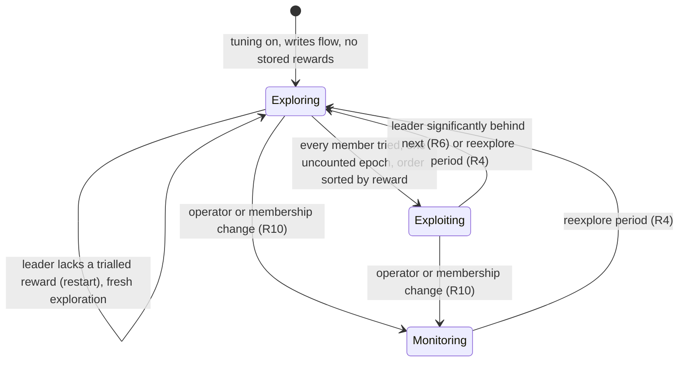
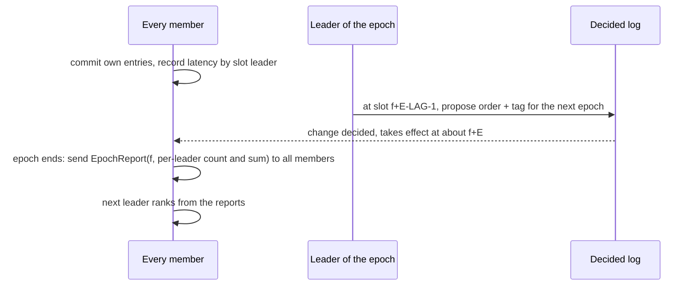
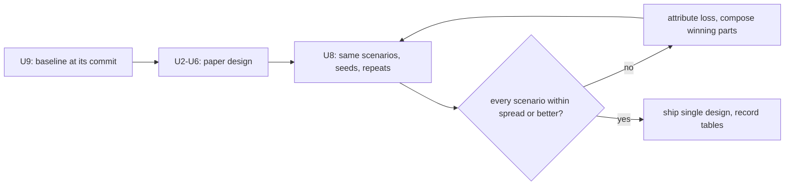

# Paper Leader and Hedging Tuning - Plan

## Goal Capsule

- **Objective:** a QuePaxa cluster finds and keeps the leader that gives its writers the lowest commit latency, including when the difference comes from a slow machine rather than the network, and each replica hedges with the delay that works best for it; across the measured scenarios the result is at least as good as today's placement and better where today's cannot see the cause.
- **Means:** the paper's explore/exploit over observed commit latency (§5.3, §3.5), carried by the existing generation-checked leader-order change (KTD1, KTD2), measured against today's implementation as the historical baseline and refined from per-scenario results (KTD9).
- **Authority:** the QuePaxa paper (SOSP 2023) wins on mechanism; measured results decide where this plan departs from it (KTD9); this plan's Requirements win where the paper is silent. Every deviation is recorded in `docs/paper-conformance.md` and `crates/quepaxa/docs/protocol.md`.
- **Stop conditions:** stop and ask if a unit needs a change to the safety-relevant schedule rule (window rule, generation check) or to any verified model; if, after U8's iterations, no design beats the baseline overall; if exploration cannot fit in epochs of a few `LAG`s.
- **Execution profile:** Deep; sequential units; the host orchestrator owns commits and the shipping workflow (PR per unit or pair, `@codex review`, green CI, squash-merge).
- **Tracks:** issue #173 (supersedes the ranking part of #147); milestone v0.7.0.

---

## Product Contract

### Summary

Measure today's round-trip placement on a fixed set of scenarios, then replace it with the paper's leader tuning (fixed-length epochs with a stable leader, a round-robin exploration giving every member two epochs as leader, an order sorted by observed commit latency, monitored every epoch and explored again when the leader is significantly behind the next) and a per-replica explore/exploit of the hedging delay. Re-run the same scenarios, compare with the baseline, and iterate on the parts that lose until the whole is at least as good everywhere. Tuning is on by default.

### Problem Frame

The paper treats leader choice and the hedging schedule as a multi-armed bandit, so that a cluster leaves a slow leader even when it has not failed (abstract, §1, §3.5, §5.3; Fig. 10 shows convergence to the fastest of heterogeneous machines in 4 s). The crate instead ranks members by measured round trips and write origins (`crates/quepaxa/src/replica/ranking.rs`). That model sees only the network: probes are answered off the commit path, so a leader with a slow disk or CPU ranks as well as a fast one, and only miss-based rotation removes it. The user requires the paper's mechanism ("需要遵守论文", "需要确保论文的完整实现") and the best overall result ("最终目标是整体最优解"); `docs/paper-conformance.md` lists the cost model as a deviation.

### Key Decisions

- **Follow the paper's bandit, not the round-trip model.** (session-settled: user-directed — chosen over "bandit with a round-trip prior" and "keep the round-trip model": the paper is the specification and the model cannot see machine heterogeneity.) Governs R1, R17.
- **The reward is observed commit latency.** (session-settled: user-directed — chosen over the paper's literal epoch completion time and over recording both: under open-loop, unsaturated load an epoch's duration measures the arrival rate, not the leader; Fig. 10 itself reports median command latency.) Governs R2.
- **Explore every member, with short epochs.** (session-settled: user-directed — chosen over default-length epochs and over skipping obviously poor candidates: skipping departs from the paper; short epochs bound the cost of trying a far region.) Governs R3.
- **On by default.** (session-settled: user-directed — chosen over keeping tuning off by default: the paper runs it always.) Governs R12.
- **Tune the hedging delay by explore/exploit too.** (session-settled: user-directed — chosen over keeping the adaptive δ and over a separate issue: the abstract names leader choice and hedging delay together.) Governs R7.
- **The paper's re-exploration rule, judged by significance.** (session-settled: user-directed — chosen over a strict comparison, the old sustain/hold/exclusion guards, a fixed-ratio margin, k consecutive worse epochs, and leaving all variants to the A/B: with near-tied members a strict comparison fires about every other epoch however many samples it has.) Governs R5, R6.
- **Periodic re-exploration (footnote 7).** (session-settled: user-directed — chosen over exploring again only when the leader falls behind: a member that became faster would otherwise never be found.) Governs R4.
- **Judge the result against today's implementation, by history, and compose from local wins.** (session-settled: user-directed — chosen over an A/B among the new design's own variants only, and over keeping both implementations side by side: the goal is the overall optimum, measured against the shipped baseline at its commit; parts of either design may combine where the data shows they win.) Governs R14, R15, R16.

### Requirements

**Leader tuning**

- R1. Slots are divided into epochs of a fixed number of slots, each led by one member; tuning starts with an exploration of 2n+1 epochs: every member of the order in force leads two epochs, round-robin, and the last trial order stays for one uncounted epoch while its reports arrive; then the order is the members sorted by observed reward, best first, agreed through the log.
- R2. A member's reward is the mean commit latency of client entries committed in slots it led and submitted after its epoch began, measured at each entry's origin and combined across members weighted by entry count.
- R3. Exploration includes every member of the order in force; epochs default to a few `LAG`s and are never shorter than `LAG + 1` slots (KTD3).
- R4. A new exploration starts every `Config::tuning_reexplore` (default 30 minutes, 0 disables) while writes flow, counted from the last exploration or the last operator or membership change.
- R5. An epoch counts only when its reported entries reach `Config::tuning_min_samples`; a member with no counted epoch is ranked after every measured one and is never placed first.
- R6. While exploiting, at the end of each counted epoch the leader starts a new exploration when its mean over its latest counted epoch exceeds the next member's stored reward by more than one standard error of the two members' per-epoch means; epochs in which any member is trying a hedge arm do not count for this test.

**Hedging delay**

- R7. Each replica chooses its hedge multiplier by explore/exploit over a fixed arm set with its own entries' commit latency as reward, only while leader tuning is exploiting; the multiplier governs when it hedges its own entries and takes over others' slots, and leaves silence detection and step-aside on today's timing.

**Safety, failure handling and precedence**

- R8. Every tuning decision is an ordinary leader-order change with the base generation (`Schedule::reconfigure`); safety does not depend on tuning, rewards or timing.
- R9. Miss-based rotation, silent-leader takeover and step-aside keep working; a rotation keeps the tuning phase and starts a new epoch at its first slot, the rotated-out member gets no counted epoch for that trial, and rewards are attributed to the leader that actually led each slot.
- R10. A membership change or an operator leader-order change (`Replica::propose_leader_order`) ends any exploration and clears the stored rewards; tuning then monitors the order in force until the next periodic exploration. During an exploration such a change may get `ReconfigurationPending` or lose to a concurrent tuning change, and the caller retries.
- R11. An idle cluster sends no tuning messages and `Replica::next_deadline` returns none; exploration pauses while no writes flow and resumes with them.

**Configuration and observability**

- R12. `Config::tuning` (default true) enables leader tuning on a member and `Config::hedge_tuning` (default true) enables hedge tuning; a member without `tuning` neither reports nor proposes, and when it leads, the next member with `tuning` proposes in its place.
- R13. Metrics expose the tuning phase, tuning-proposed order changes, and this replica's hedge multiplier; `Replica::members()` exposes each member's stored reward; the C ABI and kv-tokio expose the same.

**Evaluation and documentation**

- R14. Before the core changes, today's placement is measured on every evaluation scenario at a recorded commit (the baseline): five-region convergence, a slow machine (Fig. 10), a lasting write shift, a short burst, faults on the leader (crash, jitter, slow disk), steady load.
- R15. After the change, the same scenarios run with the same seeds and repeats; for each scenario the better design is identified with its cause, and the design is refined by composing the parts that win, re-measured each iteration, until no composition does better overall.
- R16. The final design is a single implementation, at least as good as the baseline on every scenario within run-to-run spread, and better on the slow-machine scenario; the tables, the baseline commit and every iteration's raw result directories are recorded in `docs/benchmarks.md`.
- R17. The round-trip ranking, its probes and its configuration are removed unless U8's data brings a part of them back; `docs/paper-conformance.md` marks §5.3 and the hedging-delay rows with their final status and records every deviation (reward metric, significance test, hedge arm design, failure-handling extensions, operator precedence, anything composed from the baseline).

### Acceptance Examples

- AE1. Covers R1, R2, R5. Five replicas on a LAN, the initial leader processing every message 2 ms slower: after the exploration the slowest replica is last in the order, and median commit latency is within 10% of a run pinned to the fastest.
- AE2. Covers R1, R3. Five emulated regions, leader in ap-ne, every region writing equally: after exploration us-east leads, and write p99 is at most 1.2 times that of the run pinned to us-east, with zero client errors.
- AE3. Covers R6, R4. Once exploiting with steady load, the order changes only at periodic re-explorations; jitter or 1% loss on the leader's links does not start an exploration, nor do near-tied members.
- AE4. Covers R5, R9. A member crashed during its trial is rotated out, exploration completes, and the crashed member is never placed first.
- AE5. Covers R10. An operator moves the leader during exploration, retrying through `ReconfigurationPending`: once applied, the exploration ends and the operator's order stays until the next periodic exploration.
- AE6. Covers R6. Writes shift for good from the regions near us-east to the regions near ap-ne: the leader follows within one exploration; a burst shorter than an exploration does not move it.
- AE7. Covers R11. A cluster with tuning on and no writes has no pending deadline.
- AE8. Covers R7. With a healthy leader, hedge tuning keeps multiplier 4 unless another arm is significantly faster; after it settles, a leader crash is recovered no slower than with the fixed multiplier 4.

### Success Criteria

- R16 holds: on every scenario of R14 the final design is within the baseline's run-to-run spread or better, and better on the slow-machine scenario (AE1).
- AE1, AE2 and AE6 hold in three harness runs each and in the simulator across seeds; AE3-AE5, AE7 and AE8 hold in simulator and unit tests.

### Scope Boundaries

- §6.1 batch-ID dissemination (#172), online batch and pipeline tuning (#175) and the rest of the §7 reproduction (#174) are separate issues.
- No change to the window rule, generation check, or any verified model's safety argument.
- Both designs never run side by side in the shipped code; the baseline is measured at its commit.
- Considered and not built: excluding a member after rotation demotes it (the reward already ranks a slow leader last; U8 brings it back only if the data shows rotation and tuning handing the lead back and forth).

#### Deferred to Follow-Up Work

- Real-region runs of the same scenarios (#159).

---

## Planning Contract

### Key Technical Decisions

- KTD1. **Tuning lives in a new `replica/tuning.rs`, replacing `placement.rs` and `ranking.rs` in one unit.** It keeps the parts of #169 that are about the change, not the ranking: the internal change id hidden like `retire_barrier` (`placement.moving`), its fencing, and `Schedule::settled` gating. Governs R1, R8, R17.
- KTD2. **The tuning phase is carried in the decided order change.** The `Kind::Reconfigure` payload gains a tuning tag after the order: the phase (exploring with the trial index, or exploiting) and the epoch length E. `Schedule` ignores it; the replica applies it at the change's first slot, so every member and every successive leader agrees on the phase and the epoch grid without extra messages. Epoch boundaries are that slot plus k·E, restarted at each rotation's first slot (R9); a member's own `tuning_epoch_slots` matters only when it proposes. `CoreState` stores the applied tag and its first slot, so a snapshot install or a restart after compaction recovers the phase. Version bumps: `codec::WIRE_VERSION` and `durable::FORMAT_VERSION` (old peers and logs are rejected, not misread), `core_state::VERSION` (the new state). `encode_change`/`decode_change` are not mirrored in `verification/verus/schedule.rs`, so the proofs are untouched. Governs R1, R8, R9.
- KTD3. **The default epoch is `2 · LAG` = 128 slots, never shorter than `LAG + 1`.** A change decided in slot s governs from s + `LAG`, so the leader of an epoch starting at slot f proposes the next order once it has applied slot f + E − `LAG` − 1; the epoch then lasts about E slots plus one decision. The order-change lag in time (`docs/benchmarks.md`, "Order change in time": 3.5-4.2 s on the WAN, under 0.25 s on a LAN) puts a WAN epoch near 5 s and a five-member exploration near a minute at the benchmark's slot rate; at low write rates an epoch lasts longer. U8 compares 2 · `LAG` with 4 · `LAG`. Governs R1, R3.
- KTD4. **Rewards are reported by every member to every member once per epoch.** A new `EpochReport` message (replacing the `RttProbe`/`RttReply` wire kinds 11 and 12) carries the epoch's first slot and, per leader that led slots in it, the count and latency sum of the sender's own entries. Broadcasting lets whichever member leads next hold the same table, at n² small messages per epoch. Latency is measured in `emit_commits`, where `observe_latency` runs, against `applied_schedule`'s leader of the slot; unlike `observe_latency` it includes hedged entries (a hedge is a symptom of the leader) and excludes entries submitted before the epoch began (they carry the previous leader's handover). Governs R2, R12.
- KTD5. **Re-exploration is full by default.** The paper says the cluster explores other leaders again when the leader falls behind the next; trying all of them refreshes every stale reward. U8 compares it with trying only the next member. A leader that lacks a counted reward for a member trialled in the current exploration (it restarted or installed a snapshot since) proposes a fresh exploration instead of a sorted order. Governs R1, R6.
- KTD6. **Hedge arms are multipliers 1, 2, 4 and 8 of the smoothed commit latency, applied in `late_at` and `takeover_at` only.** `silence_wait` and `aside_at` (`replica/watch.rs`) keep today's fixed 4×, so silent-leader takeover and step-aside timing do not move. Each arm runs two counted epochs; the replica keeps 4 unless another arm's mean is lower by more than one standard error of the per-epoch means, the same significance rule as R6. The choice is local and needs no agreement. The paper gives no concrete method for δ; this design is recorded as such. Governs R7.
- KTD7. **The simulator gains a per-replica processing delay** (`SimConfig`), since disks are the only heterogeneity it models today (`disk_slow`, `slow_persist_ms`). The harness emulates a slow machine with a Docker CPU quota on one replica. Governs R14, R15.
- KTD8. **Configuration replaces `placement`, `placement_sustain` and `placement_hold`.** New fields: `tuning`, `hedge_tuning`, `tuning_epoch_slots`, `tuning_min_samples` (default 32, set by U8), `tuning_reexplore`. The C ABI's config keys 8-10 are replaced (minor version 0.11) and a key is added for each new field; `Metrics::placement_moves` becomes `tuning_moves`; `MemberView::round_trip` becomes the stored reward. kv-tokio's `--placement` becomes `--tuning on|off` and `--hedge-tuning on|off`. Governs R12, R13, R17.
- KTD9. **The evaluation is historical and iterative.** The scenario harness (U1, U7) lands first and runs against today's placement at its commit (U9); the core changes then replace it outright. U8 re-runs the scenarios, attributes each loss to a cause, and changes the design where a part of either design wins: for example, a round-trip ordering of the exploration or a prior that shortens it, restored from git history. Each iteration is measured on every scenario, and only the final design ships. Governs R14, R15, R16, R17.

### High-Level Technical Design

Phase state machine per replica, driven by applied order changes (KTD2) and epoch reports (KTD4):

Monitoring is exploiting with no stored rewards to compare, so R6 cannot fire until an exploration has refilled them.

One epoch, leader L, epoch from slot f, length E from the tag:

The evaluation loop (KTD9):

### Assumptions

- The order-change lag of 64 slots stays as it is; a shorter lag would allow shorter epochs.
- A Docker CPU quota on one container is a fair stand-in for the paper's slower EC2 instance type.

### Sequencing

U1 and U7 build the scenarios on today's code; U9 measures the baseline. U2-U4 change the core in dependency order; U2 removes both old files so every unit compiles. U5 updates every external surface at once (one C ABI bump). U6 replaces the placement test suite. U8 compares, iterates and documents.

---

## Implementation Units

### U1. Model a slow machine in the simulator

- **Goal:** a replica can process every message a fixed time later than the others, so the simulator can reproduce the paper's Fig. 10 case.
- **Requirements:** R14; KTD7.
- **Dependencies:** none.
- **Files:** `crates/quepaxa-sim/src/config.rs`, `crates/quepaxa-sim/src/lib.rs`, `crates/quepaxa-sim/tests/replica_sim.rs`.
- **Approach:** a `SimConfig` field naming replicas and an added processing delay; the delivery loop delays each step of a named replica by it. Defaults leave every existing test unchanged.
- **Patterns to follow:** `disk_slow` in `crates/quepaxa-sim/src/lib.rs`.
- **Test scenarios:**
  - A three-replica LAN run with the leader slowed by 2 ms per message has a higher median commit latency than the same seed without it.
  - With no slowed replica, a seed's trace hash is unchanged from before the field existed.
- **Verification:** existing simulator suites pass with identical results on their default seeds.

### U7. Harness scenarios for the evaluation

- **Goal:** the five-region harness and a LAN run cover every R14 scenario, on today's placement first.
- **Requirements:** R14; KTD7, KTD9.
- **Dependencies:** U1.
- **Files:** `examples/kv-tokio/bench/etcd/wan.sh`, `examples/kv-tokio/bench/etcd/summarize-wan.sh`, `examples/kv-tokio/src/bin/kv-bench/main.rs`, `examples/kv-tokio/src/bin/kv-bench/etcd.rs`, `crates/quepaxa-sim/tests/evaluation.rs` (new).
- **Approach:**
  1. A `convergence` scenario: minutes long, leader starting in ap-ne, leader-policy knobs from the environment.
  2. A `heterogeneous` scenario: no WAN delay, one replica's container under a CPU quota, starting as leader (Fig. 10).
  3. `kv-bench --rate-at SECS:RATE` (repeatable) for the write shift and the burst.
  4. The summary reports time to the final leader, order changes in steady state, and p99 before and after it.
  5. The simulator counterpart runs the same scenarios across seeds and prints one table row per scenario.
- **Test scenarios:**
  - `--rate-at` parsing: `10:200,40:0` yields two steps; a malformed step is rejected.
  - The simulator evaluation runs every scenario on two seeds and prints a complete table.
- **Verification:** `wan.sh --smoke convergence heterogeneous` completes and writes a summary.

### U9. Measure the baseline

- **Goal:** today's placement measured on every R14 scenario, recorded at its commit.
- **Requirements:** R14, R16; KTD9.
- **Dependencies:** U1, U7.
- **Files:** `docs/benchmarks.md`.
- **Approach:** run the simulator evaluation across seeds and the harness scenarios three times each with today's placement (`--placement on`, its default periods scaled as the harness documents); record the tables, the commit and the raw result directories.
- **Test scenarios:** Test expectation: none -- measurement only.
- **Verification:** `docs/benchmarks.md` has a baseline row for every R14 scenario with its spread.

### U2. Measure rewards and exchange epoch reports

- **Goal:** every member knows, per epoch, the write-weighted commit latency under each leader that led in it.
- **Requirements:** R2, R5, R11, R12; KTD1, KTD2, KTD3, KTD4, KTD8.
- **Dependencies:** U9.
- **Files:** `crates/quepaxa/src/replica/tuning.rs` (new), `crates/quepaxa/src/replica/tuning_tests.rs` (new), `crates/quepaxa/src/replica/placement.rs`, `placement_tests.rs`, `ranking.rs` and `ranking_tests.rs` (removed), `crates/quepaxa/src/codec.rs`, `crates/quepaxa/src/replica/messages.rs`, `crates/quepaxa/src/replica/log.rs`, `crates/quepaxa/src/api.rs`, `crates/quepaxa/src/replica/mod.rs`.
- **Approach:**
  1. Remove the round-trip placement and its probes; add `EpochReport` (KTD4) and the tuning config fields (KTD8), with tuning proposing nothing yet.
  2. In `emit_commits`, attribute each own committed entry's latency to `applied_schedule`'s leader of its slot, per epoch of the tag's grid (KTD2).
  3. At an epoch's end, broadcast the report; on receipt, store it per epoch and leader, ignoring members outside the order in force.
  4. An epoch's reward counts only with at least `tuning_min_samples` entries (R5).
  5. No timer fires without writes (R11): reports go out on the slot that ends an epoch, not on a clock.
- **Patterns to follow:** `count_writes` and `on_rtt_probe` in today's `replica/placement.rs`; codec kinds in `crates/quepaxa/src/codec.rs` with golden bytes.
- **Test scenarios:**
  - Three members each report 10 entries at 4 ms and one reports 30 entries at 8 ms for the same epoch and leader: the stored reward is 6 ms.
  - An epoch whose reports total fewer than the minimum samples has no reward.
  - An entry submitted before its epoch began does not count toward that epoch.
  - An epoch with a rotation in it yields one reward per leader that led slots in it.
  - A report from a member outside the order in force is ignored.
  - A member without `tuning` sends no report, and the reward comes from the others.
  - An idle replica with tuning on has no deadline (Covers AE7).
  - `EpochReport` round-trips through the codec and matches its golden bytes.
- **Verification:** unit tests pass; `cargo build -p quepaxa --target thumbv7em-none-eabihf` builds.

### U3. Explore, exploit and re-explore the leader

- **Goal:** the leader in force drives the §5.3 phases through ordinary order changes.
- **Requirements:** R1, R3, R4, R5, R6, R8, R9, R10, R12; KTD1, KTD2, KTD3, KTD5.
- **Dependencies:** U2.
- **Files:** `crates/quepaxa/src/replica/tuning.rs`, `crates/quepaxa/src/replica/tuning_tests.rs`, `crates/quepaxa/src/schedule.rs` (tag in the change encoding), `crates/quepaxa/src/codec.rs`, `crates/quepaxa/src/durable.rs`, `crates/quepaxa/src/core_state.rs`, `crates/quepaxa/src/replica/log.rs`, `crates/quepaxa/src/replica/snapshot.rs`, `crates/quepaxa/src/replica/retire.rs`.
- **Approach:**
  1. Extend the change payload with the tag and store the applied tag in `CoreState`, with the three version bumps (KTD2).
  2. As leader, at slot f + E − `LAG` − 1, propose the next order: the next trial member first while exploring, the sorted order after the uncounted epoch (R1), or nothing while exploiting unless R6 or R4 fires.
  3. A rotation restarts the epoch grid and keeps the phase (R9).
  4. When the leader has no `tuning`, the next member with `tuning` proposes once the epoch has run past f + E (R12); the base generation rejects duplicates.
  5. Keep the internal-change handling of #169 (KTD1).
  6. An operator or membership change applied in the log clears rewards, ends exploration and restarts the R4 period (R10).
  7. A leader missing a trialled member's reward proposes a fresh exploration (KTD5).
- **Patterns to follow:** `evaluate_placement` and `note_applied` in today's `replica/ranking.rs` (in git history after U2); `Schedule::settled` gating in `may_move`.
- **Test scenarios:**
  - Five members, exploring from member 0: the proposed orders put members 1 to 4 first in turn, two epochs each, keep the last trial for one uncounted epoch, then propose the sorted order (Covers AE1).
  - Rewards 3, 5, 2, 9, 4 ms after exploration: the proposed order is members 2, 0, 4, 1, 3.
  - While exploiting, the leader's latest epoch is behind the next member by more than one standard error: a new exploration starts.
  - While exploiting, two near-tied members whose difference is within one standard error: nothing is proposed over many epochs (Covers AE3).
  - An epoch in which a member is trying a hedge arm does not trigger re-exploration.
  - The re-exploration period elapses with writes flowing: a new exploration starts (Covers AE3).
  - The trial member crashes and is rotated out: exploration continues from the rotated-in leader and the crashed member ranks last (Covers AE4).
  - An operator order change submitted during exploration gets `ReconfigurationPending`, succeeds on retry, ends the exploration and clears rewards (Covers AE5).
  - A membership change during exploration ends it; the new members are explored at the next period.
  - A member without `tuning` leads a trial: the next member with `tuning` proposes the next order.
  - A stale tuning change (base generation older than the order in force) is ignored when decided (Covers R8).
  - A snapshot taken mid-exploration, installed on a lagging replica, yields the same phase and epoch grid.
  - A leader restarted during the last trial proposes a fresh exploration rather than a sorted order.
- **Verification:** unit tests pass; `cargo nextest run --release -p quepaxa-sim --test model_check` stays exhaustive.

### U4. Tune the hedging delay per replica

- **Goal:** each replica picks its hedge multiplier by explore/exploit.
- **Requirements:** R7; KTD6.
- **Dependencies:** U3.
- **Files:** `crates/quepaxa/src/replica/tuning.rs`, `crates/quepaxa/src/replica/watch.rs` (`late_at`, `takeover_at`), `crates/quepaxa/src/replica/proposing.rs` (`hedge_delay`), `crates/quepaxa/src/replica/tuning_tests.rs`, `crates/quepaxa/src/replica/watch_tests.rs`.
- **Approach:** while leader tuning exploits, run each arm for two counted epochs of the replica's own entries, then apply KTD6's rule; explore the arms again whenever the leader tuning re-explores. Without `hedge_tuning`, the multiplier stays 4.
- **Patterns to follow:** `Replica::hedge_delay`, `observe_latency`.
- **Test scenarios:**
  - Arm means 6, 5, 5, 7 ms with a standard error of 1 ms: the replica keeps multiplier 4.
  - Arm 2 significantly faster than arm 4: the replica moves to 2.
  - During leader exploration the arm does not change.
  - With `hedge_tuning` off, `late_at` and `takeover_at` equal today's.
  - Under arm 1, `silence_wait` and `aside_at` are unchanged.
  - Every arm stays within `[hedge_min, hedge_max]`.
- **Verification:** unit tests pass; `crates/quepaxa-sim/tests/leader_loss.rs` and `disk_faults.rs` still pass.

### U5. Expose tuning: metrics, members, C ABI 0.11, kv-tokio

- **Goal:** operators and hosts see and control tuning.
- **Requirements:** R12, R13, R17; KTD8.
- **Dependencies:** U4.
- **Files:** `crates/quepaxa/src/api.rs`, `crates/quepaxa/src/replica/mod.rs`, `crates/quepaxa-ffi/src/*.rs`, `crates/quepaxa-ffi/include/quepaxa.h`, `crates/quepaxa-ffi/symbols.txt`, `crates/quepaxa-ffi/tests/c_abi.rs`, `examples/kv-tokio/src/main.rs`, `examples/kv-tokio/src/node.rs`, `examples/kv-tokio/bench/etcd/wan.sh`.
- **Approach:** replace the placement metric, config keys and member field (KTD8); add `tuning_phase` and `hedge_multiplier` metrics; regenerate the header with cbindgen; kv-tokio's STATS line reports the phase and multiplier; `wan.sh` passes the new flags.
- **Patterns to follow:** #171's surfaces (`QPX_METRIC_*`, `QPX_CONFIG_*`, `STATS ... LEADERS`).
- **Test scenarios:**
  - Each new C config key round-trips through `qpx_config_set` and rejects an out-of-range value (an epoch shorter than `LAG + 1`).
  - Each new metric reads back through the C ABI.
  - `--tuning off` and `--hedge-tuning off` parse and disable their tunings.
- **Verification:** `cargo miri test -p quepaxa-ffi` passes; the header regenerates unchanged; `nm` symbols match `symbols.txt`.

### U6. Replace the placement tests with tuning tests and canaries

- **Goal:** the simulator, model checker and canaries cover tuning.
- **Requirements:** R1-R12; AE1-AE8.
- **Dependencies:** U5.
- **Files:** `crates/quepaxa-sim/tests/placement.rs` (replaced by `tuning.rs`), `crates/quepaxa-sim/tests/replica_sim.rs`, `crates/quepaxa-sim/src/config.rs`, `crates/quepaxa-sim/src/lib.rs`, `verification/canaries.tsv`, `verification/canaries/*.patch`, `.github/workflows/ci.yml`, `.github/workflows/nightly.yml`, `VERIFICATION.md`.
- **Approach:** port the five-region and write-shift scenarios to the new mechanism, add the slow-machine scenario, keep the faults-plus-reconfiguration safety run with tuning on.
- **Test scenarios:**
  - Covers AE1. LAN, five replicas, the initial leader slowed: the slowest ends last and median latency is within 10% of the run pinned to the fastest.
  - Covers AE2. Five regions from ap-ne: us-east leads after exploration.
  - Covers AE6. Writes shift for good: the leader follows within one exploration; a short burst moves nothing.
  - Covers AE3. Steady load with jitter on the leader's links and hedge tuning on: the order changes only at periodic re-explorations.
  - Covers AE4. A member killed during exploration is never first afterwards.
  - Covers AE8. Healthy leader: no replica's hedge count exceeds that of the fixed multiplier 4 on the same seed, and a leader crash after hedge tuning settles stalls no longer than with multiplier 4.
  - Faults, crashes and membership changes with tuning on: every replica-sim invariant holds and tuning moves at least once.
  - Canary: exploration skips a member; the five-region test fails with its expected message.
  - Canary: the significance test is replaced by a strict comparison; the steady-state test fails with its expected message.
- **Verification:** `RUSTFLAGS="-D warnings" verification/canaries.sh` catches both new canaries; CI runs the tuning tests in the release step.

### U8. Compare with the baseline, iterate, document

- **Goal:** the final design chosen from measurements against the baseline, and the paper-conformance record updated.
- **Requirements:** R15, R16, R17; KTD3, KTD5, KTD6, KTD9.
- **Dependencies:** U6, U9.
- **Files:** `crates/quepaxa/src/api.rs` (defaults), `crates/quepaxa/src/replica/tuning.rs` (iterations), `docs/benchmarks.md`, `docs/paper-conformance.md`, `crates/quepaxa/docs/protocol.md`, `crates/quepaxa/docs/tuning.md`, `crates/quepaxa/docs/membership.md`, `VERIFICATION.md`, `CHANGELOG.md`, `README.md`.
- **Approach:**
  1. Run U7's scenarios with the same seeds and repeats as U9; compare per scenario.
  2. For each loss, find the cause, change the design where a part of either design wins (KTD9), and re-run every scenario; parameter variants (minimum samples 1, 32, 128; epoch 2 · `LAG` or 4 · `LAG`; full or next-only re-exploration; hedge tuning on or off) are part of this search.
  3. Stop when no change does better overall, or stop and ask if nothing beats the baseline (Goal Capsule).
  4. Set the defaults; record the baseline, each iteration and the final tables with their raw result directories in `docs/benchmarks.md`.
  5. Update the conformance rows and record each deviation (R17); `crates/quepaxa/docs/tuning.md` documents R10's retry; CHANGELOG lists the breaking changes (wire, durable and core-state versions, change encoding, config, metrics, C ABI 0.11, kv-tokio flags).
- **Test scenarios:** Test expectation: none beyond U6 -- an iteration that changes behavior updates U6's tests in the same change.
- **Verification:** R16 holds on the recorded tables; AE1, AE2 and AE6 hold in three harness runs each with the chosen defaults; every doc row cites its evidence.

---

## Verification Contract

| Gate | Command | Applies to |
|---|---|---|
| Workspace tests | `cargo nextest run --workspace --no-fail-fast` | all |
| Simulator | `cargo nextest run --release -p quepaxa-sim` (raise `QPX_SIM_SEEDS` locally) | U1, U3, U4, U6, U7 |
| Model checking | `cargo nextest run --release -p quepaxa-sim --test model_check` | U3, U6 |
| Canaries | `RUSTFLAGS="-D warnings" verification/canaries.sh` | U6 |
| C ABI | `cargo miri test -p quepaxa-ffi`; cbindgen header unchanged; `nm` symbols match `crates/quepaxa-ffi/symbols.txt` | U5 |
| Lint and supply chain | `cargo clippy --workspace --all-targets -- -D warnings`, `cargo fmt --all --check`, `cargo deny check`, `cargo doc --workspace --no-deps` with `-D warnings` | all |
| no_std | `cargo build -p quepaxa --target thumbv7em-none-eabihf` | U2, U3, U4 |
| Evaluation | `cargo nextest run --release -p quepaxa-sim --test evaluation --no-capture`; `examples/kv-tokio/bench/etcd/wan.sh convergence heterogeneous` | U7, U9, U8 |

---

## Definition of Done

- R1-R17 hold, each traced to a passing test or a recorded run; AE1-AE8 as the units state.
- The baseline and final tables are in `docs/benchmarks.md`, and R16 holds on them.
- `placement.rs`, `ranking.rs`, their tests, the probe wire kinds and the placement config are gone unless U8 brought a part back; no abandoned iteration remains in the diff.
- `next_deadline` returns none in an idle cluster with tuning on.
- Every new canary is listed in `verification/canaries.tsv` and caught.
- `docs/paper-conformance.md` shows the final status of §5.3 and the hedging-delay rows, with every deviation recorded; CHANGELOG records the breaking changes.

---

## Appendix

### Sources

- Paper §5.3 "Leader tuning in QuePaxa", §3.5 "Auto-tuning", Fig. 10, footnote 7 (restless bandits).
- `docs/paper-conformance.md` (PR #176); issues #173, #147.
- `docs/plans/2026-11-07-1324-feat-leader-placement-plan.md`: units U1-U7 shipped the change path and surfaces this plan reuses; its U8 is superseded.
- `docs/benchmarks.md`, "Order change in time": the lag in time that bounds the epoch length.
- Timing call sites the hedge multiplier touches: `late_at`, `takeover_at`, `silence_wait`, `aside_at` in `crates/quepaxa/src/replica/watch.rs`.
